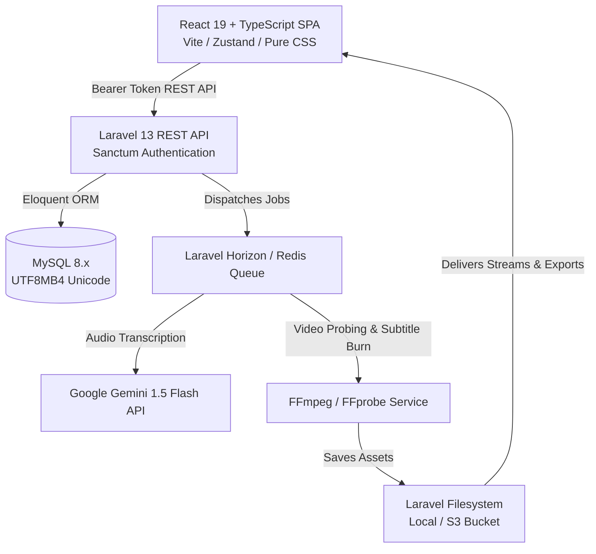
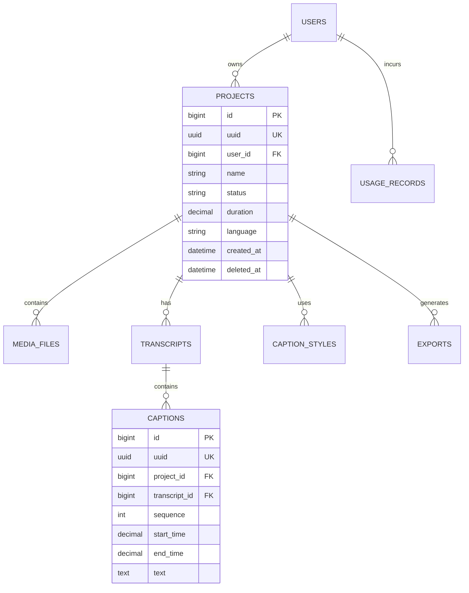

# Architecture & System Design

This document details the architectural principles, domain modeling, and technical patterns behind **SampleCap**.

---

## 1. High-Level Architecture Overview



---

## 2. Centralized Branding Engine

A primary architectural requirement is ensuring that the product name, visual tokens, and logos can be updated in a single place without searching through hundreds of files.

### Frontend Centralization (`frontend/src/config/brand.ts`)
- Defines the `BRAND` configuration object with `name`, `shortName`, `logoText`, `tagline`, and `colors`.
- The `useBrand()` hook supplies this context to components, navigation bars, and headers.
- The `useDocumentTitle()` hook dynamically formats the browser tab title as `${pageTitle} • ${BRAND.name}`.

### Backend Centralization (`backend/config/brand.php`)
- Serves as the backend source of truth for email templates, notifications, and metadata.
- Exposes `GET /api/brand` allowing any connected client to dynamically synchronize branding details.

### Rebranding Workflow
Changing the temporary name **"SampleCap"** to **"පේළිCap"** requires modifying only `frontend/src/config/brand.ts` and `backend/config/brand.php`. Because both front and back ends adhere to UTF-8/UTF8MB4, Unicode Sinhala characters render seamlessly across all interfaces.

---

## 3. Backend Clean Architecture

Controllers remain thin; all business logic is encapsulated in single-responsibility **Actions** and reusable **Services**.

```text
app/
├── Actions/
│   ├── Auth/
│   │   ├── RegisterUserAction.php
│   │   └── LoginUserAction.php
│   └── Projects/
│       ├── CreateProjectAction.php
│       ├── UpdateProjectAction.php
│       └── DeleteProjectAction.php
├── Services/
│   ├── AI/
│   │   ├── Contracts/CaptionAIServiceInterface.php
│   │   └── GeminiCaptionService.php
│   ├── Video/
│   │   ├── Contracts/VideoServiceInterface.php
│   │   └── FFmpegService.php
│   ├── Caption/
│   │   ├── Contracts/SubtitleFormatterInterface.php
│   │   ├── SubtitleFormatterService.php
│   │   └── SinhalaTextNormalizerService.php
│   └── Export/
│       └── ExportManagerService.php
├── Jobs/
│   ├── ProcessVideoTranscriptionJob.php
│   └── RenderVideoWithCaptionsJob.php
├── Policies/
│   └── ProjectPolicy.php
└── Traits/
    └── ApiResponseTrait.php
```

### Consistent JSON Response Envelope
Every API response strictly follows the unified structure:
```json
{
  "success": true,
  "message": "Project created successfully",
  "data": { ... }
}
```

HTTP status codes are handled uniformly in `bootstrap/app.php`:
- `401`: `{ "success": false, "message": "Unauthenticated. Please log in.", "data": {} }`
- `403`: `{ "success": false, "message": "Access denied.", "data": {} }`
- `404`: `{ "success": false, "message": "Resource not found.", "data": {} }`
- `422`: `{ "success": false, "message": "Validation failed.", "data": {}, "errors": { ... } }`
- `429`: `{ "success": false, "message": "Too many requests.", "data": {} }`
- `500`: `{ "success": false, "message": "An internal server error occurred.", "data": {} }`

---

## 4. Database Schema & Domain Modeling

All primary entities use **UUIDs** as public route identifiers to prevent ID enumeration.



---

## 5. Unicode & Sinhala Language Support

1. **Database Collation**: All tables are created with `utf8mb4` character set and `utf8mb4_unicode_ci` collation.
2. **Sinhala Normalizer**: `SinhalaTextNormalizerService` processes complex conjuncts (bandi akuru), removes orphan Zero-Width Joiners (ZWJ), and provides accurate word-boundary counting.
3. **Typography**: The frontend bundles Google Fonts (`Inter` and `Noto Sans Sinhala`), ensuring proper rendering of all Sinhala vowel signs (al-lakuna, ispilla, papilla).

---

## 6. Frontend Architecture (No Tailwind CSS)

- **Pure CSS Design Tokens**: Built using modern CSS custom properties in `src/styles/variables.css` matching required palette:
  - Primary: `#5B21B6`
  - Accent: `#F97316`
  - Dark: `#171717`
  - Background: `#F8FAFC`
  - Light Purple: `#F5F3FF`
- **State Management**:
  - `authStore`: User profile, Sanctum Bearer token persistence, session boot.
  - `projectStore`: Project catalog, dashboard metrics cache, CRUD triggers.
  - `toastStore`: Global non-blocking notification queue.
- **Dark Editor Interface**: `ProjectDetailsPage` is styled with a sleek dark theme (`--editor-bg: #121212`) ready for video scrubbing and timeline manipulation.

---

## 7. Roadmap for STEP 2 (Video Caption Editor)

This codebase provides the architectural foundation for Step 2:
1. **Interactive Audio Waveform**: Integrate wavesurfer.js / Web Audio API for visual subtitle boundary dragging.
2. **Real-Time Video Player Sync**: Synchronize active caption highlight with HTML5 video `timeupdate` events.
3. **In-Browser Caption Styling**: Visual font picker, color palette, outline radius, and subtitle position adjustment.
4. **Asynchronous FFmpeg Render Pipeline**: Background queue worker processing burned MP4 videos with progress telemetry.

---

## 8. Browser Caption Editor (STEP 3)

Route: `/projects/:uuid/editor` (lazy-loaded). Code lives in `frontend/src/features/editor/` and `frontend/src/stores/editor/`.

### State — six small stores, no god object

| Store | Owns | Notes |
|---|---|---|
| `editorProjectStore` | project uuid/name, base `settings`, load + save status | Save status: `saved · saving · unsaved · failed · offline` |
| `videoStore` | currentTime, duration, play state, volume, rate, captions visibility | Written only by `services/playback.ts` |
| `captionStore` | **the document** (`captions`, `style`, `customPresets`, `canvas`) + undo/redo history | Everything persisted and undoable lives here |
| `timelineStore` | zoom (px/s), snapping, overlap prevention, follow-playhead, drag feedback | |
| `editorStore` | selection, active tool, style scope (all vs one caption), nudge step | |
| `uiStore` | preview mode, dialogs, tablet drawers, mobile tab | |

`currentTime` updates every animation frame while playing. Components never subscribe to it directly unless they must:
the playhead and clocks write to the DOM from a store subscription, and `useActiveCaptionId()` re-renders only when the *active caption* changes.

### History
Whole-document snapshots with structural sharing (cheap). `commit()` = one entry; `coalesceKey` merges bursts (typing in one caption, scrubbing one slider, repeated nudges) within 1 s; `beginTransaction/endTransaction` wraps drags so a drag is one undo step. Undo restores the selection too.

### Persistence
`services/autosave.ts` debounces 800 ms after the last change (never during a drag), sends only dirty parts, never overlaps saves, retries with backoff, and blocks tab close while unsaved.
- Captions → `PUT /projects/{uuid}/captions/sync`. Caption ids are **client-generated UUIDs** and double as the DB `uuid`; sync restores soft-deleted rows so undoing a delete works.
- Style, custom presets, canvas → `PATCH /projects/{uuid}` as `settings.editor` (merged with existing settings; `version: 2`).
- Per-caption overrides → `captions.style_override`. `captions.metadata.editor_version = 2` marks data written by this editor; older overrides are migrated on load (`sanitizeStyle(..., legacy)`).

### Rendering contract for STEP 4 (export)
- Style pixel values (`fontSize`, `padding`, `outlineWidth`, shadow, radius) are in **1080p reference units**: relative to a frame whose *short side* is 1080 px. Preview scales by `min(w,h)/1080`; a renderer should do the same.
- `positionX/positionY` are anchor percentages of the frame; `alignMatrix` decides which corner/edge of the text box sits on the anchor. `maxWidth` is % of frame width.
- Stroke is drawn *outside* the glyphs (outline layer under a fill layer). Shadow belongs to the outline layer.
- `canvas.aspect` (`source | 16:9 | 9:16 | 1:1 | 4:5`) is the output frame; video is letterboxed (`contain`).
- Timed animations (`karaoke`, `highlight`, `typewriter`) use `words[]` timings when present, otherwise `getWordTimings()` estimates them by token length.
- Use `features/editor/services/serialization.ts` + `utils/captionStyle.ts` from the exporter so preview and export cannot drift.

### Unicode / Sinhala
Text is NFC-normalised (ZWJ/ZWNJ preserved). `splitGraphemes()` keeps Sinhala syllables and ZWJ conjuncts (ශ්‍රී, ක්‍ෂ) intact for splitting and the typewriter effect. Fonts: a Latin font first in the stack, then a Sinhala font, so mixed-script captions render each script in its own face. Shortcuts ignore keys during IME composition.

---

## 9. Styling, Templates & Export (STEP 4)

### Style model & presets
- One style object (see §8) is shared by the editor preview, saved templates and the MP4 renderer. The backend validates it with `App\Services\Caption\CaptionStyleNormalizer` (twin of the editor's `sanitizeStyle`).
- The 7 built-in presets (Modern, Bold, Minimal, Cinema, YouTube, TikTok, Classic) are structured configuration in **`presets.json`**, kept in two identical copies: `frontend/src/features/editor/model/presets.json` (editor) and `backend/resources/captions/presets.json` (system templates). A backend test fails if they drift.

### Templates (`caption_templates`)
| Column | Notes |
|---|---|
| `uuid`, `user_id` (NULL = system), `slug` | System templates are keyed by preset slug |
| `name`, `description`, `category`, `preview_text`, `sort_order` | |
| `is_system` | Read-only for users |
| `style` (JSON) | Full style: font, size, weight, italic, colours, stroke, shadow, background, padding, radius, alignment, position, animation |

API: `GET/POST /api/caption-templates`, `DELETE /api/caption-templates/{uuid}`. System templates are synced from `presets.json` (`php artisan captions:sync-templates`, also run by the seeder and on first listing). Applying a **system** template changes only the look; a **user** template also carries its layout.

### Exports
`exports`: `uuid, project_id, user_id, type (srt|vtt|txt|json|mp4), status (queued|processing|completed|failed), progress, file_path, file_size, error_message, metadata, started_at, completed_at`.

| Endpoint | |
|---|---|
| `POST /api/projects/{project}/exports` | `{type, resolution?: 720\|1080\|2160\|source, quality?: high\|standard\|small, template?: uuid}` |
| `GET /api/projects/{project}/exports` | Latest 50 |
| `GET /api/exports/{export}` | Status/progress + short-lived `download_url` when completed |
| `DELETE /api/exports/{export}` | Deletes the file; cancels a running render |
| `GET /api/exports/{export}/download` | **Signed URL only** (30 min); never exposes storage paths |

- Text formats are generated immediately by `SubtitleFormatterService` (UTF-8, NFC; SRT skips empty cues and never prints `,1000` ms; VTT escapes `& < >`).
- MP4: `ExportService` snapshots the style and queues **`RenderVideoJob`** (never rendered in the HTTP request). Pipeline: captions → `AssCaptionRenderer` (ASS script) → `VideoRendererService` (FFmpeg + libass) → private disk → export record. Max 2 active renders per user. 4K is only offered when the source's short side ≥ 2160.
- Files live on the **private** `local` disk (`exports/{project}/{export}.{ext}`); downloads use `URL::temporarySignedRoute`.
- The editor's source video is also served through a signed, Range-capable stream (`GET /api/media/{uuid}/stream`), so seeking works even on `php artisan serve` (which cannot serve byte ranges).

### Rendering (FFmpeg)
- **Requirements:** FFmpeg with **libass ≥ 0.17** + HarfBuzz (`brew install ffmpeg-full` on macOS; `apt install ffmpeg` on Debian 12 / Ubuntu 24.04), and caption fonts installed with `php artisan captions:install-fonts` (static TTFs into `storage/app/fonts`).
- `AssCaptionRenderer` mirrors the preview: 1080p reference units scaled by `min(W,H)/1080`; layers = background box (BorderStyle 4, one padded box) → shadow (offset + blur) → outlined text; font runs follow the CSS fallback of the stack `<English font>, <Sinhala font>` (only Sinhala-block chars + ZWJ/ZWNJ use the Sinhala font); each run uses the exact installed face (`FontRegistry` reads the TTF name table — libass ignores `\b600` on the base family) and a size corrected for the font's win ascent/descent; karaoke / word box / typewriter become timed events.
- `VideoRendererService` builds an argv array (no shell), prefixes paths with `file:`, escapes filtergraph values (`FilterEscaper`, both FFmpeg escaping levels), whitelists encoder values, parses `-progress` output and supports cancellation. Process execution sits behind `ProcessRunner` so tests can fake FFmpeg.
- **Known differences from the preview** (libass limits, marked "preview only" in the editor): rounded box corners and custom line height are not rendered.

### Operations
- Run a worker: `php artisan queue:work` (or a dedicated queue: set `RENDER_QUEUE=renders` and run `php artisan queue:work --queue=renders,default`). **Restart workers after deploying code** (`php artisan queue:restart`) — long-running workers keep old code in memory.
- STEP 5 follow-ups: clean up export files when projects are deleted; storage quotas/retention for exports; S3 support for render inputs (the job currently reads the source via a local path); per-plan render limits.
