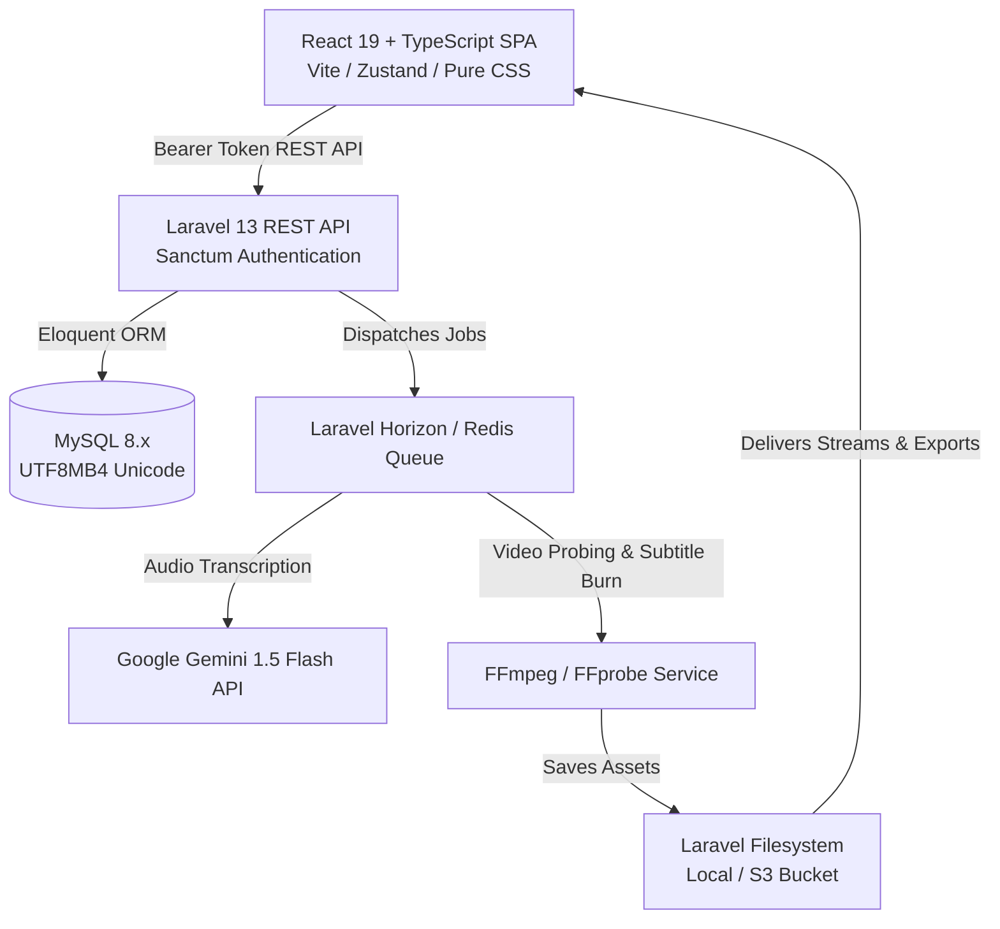
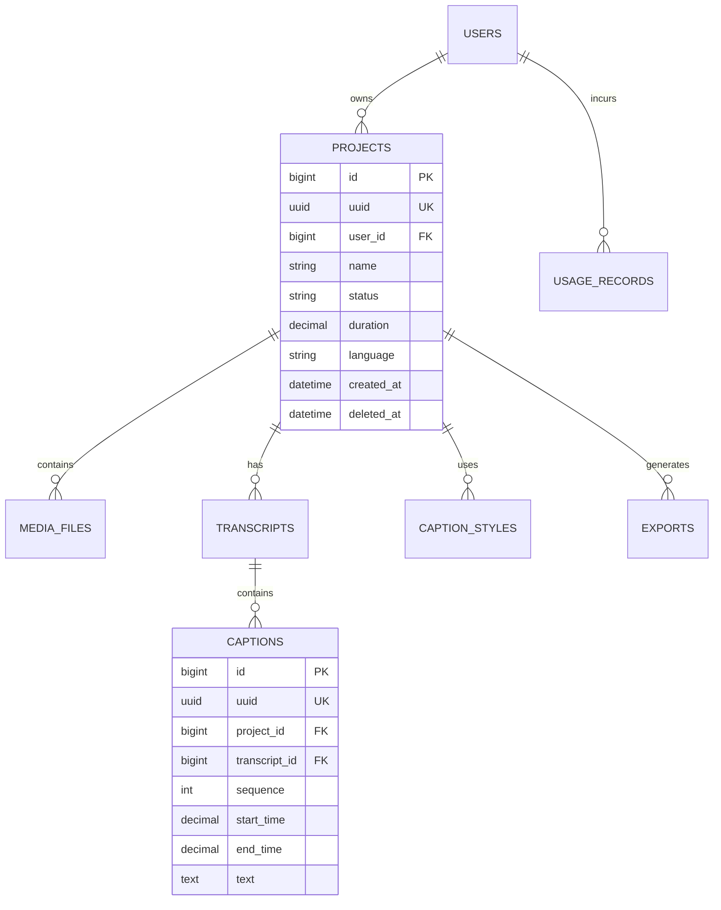

# Architecture & System Design

This document details the architectural principles, domain modeling, and technical patterns behind **SampleCap**.

---

## 1. High-Level Architecture Overview



---

## 2. Centralized Branding Engine

A primary architectural requirement is ensuring that the product name, visual tokens, and logos can be updated in a single place without searching through hundreds of files.

### Frontend Centralization (`frontend/src/config/brand.ts`)
- Defines the `BRAND` configuration object with `name`, `shortName`, `logoText`, `tagline`, and `colors`.
- The `useBrand()` hook supplies this context to components, navigation bars, and headers.
- The `useDocumentTitle()` hook dynamically formats the browser tab title as `${pageTitle} • ${BRAND.name}`.

### Backend Centralization (`backend/config/brand.php`)
- Serves as the backend source of truth for email templates, notifications, and metadata.
- Exposes `GET /api/brand` allowing any connected client to dynamically synchronize branding details.

### Rebranding Workflow
Changing the temporary name **"SampleCap"** to **"පේළිCap"** requires modifying only `frontend/src/config/brand.ts` and `backend/config/brand.php`. Because both front and back ends adhere to UTF-8/UTF8MB4, Unicode Sinhala characters render seamlessly across all interfaces.

---

## 3. Backend Clean Architecture

Controllers remain thin; all business logic is encapsulated in single-responsibility **Actions** and reusable **Services**.

```text
app/
├── Actions/
│   ├── Auth/
│   │   ├── RegisterUserAction.php
│   │   └── LoginUserAction.php
│   └── Projects/
│       ├── CreateProjectAction.php
│       ├── UpdateProjectAction.php
│       └── DeleteProjectAction.php
├── Services/
│   ├── AI/
│   │   ├── Contracts/CaptionAIServiceInterface.php
│   │   └── GeminiCaptionService.php
│   ├── Video/
│   │   ├── Contracts/VideoServiceInterface.php
│   │   └── FFmpegService.php
│   ├── Caption/
│   │   ├── Contracts/SubtitleFormatterInterface.php
│   │   ├── SubtitleFormatterService.php
│   │   └── SinhalaTextNormalizerService.php
│   └── Export/
│       └── ExportManagerService.php
├── Jobs/
│   ├── ProcessVideoTranscriptionJob.php
│   └── RenderVideoWithCaptionsJob.php
├── Policies/
│   └── ProjectPolicy.php
└── Traits/
    └── ApiResponseTrait.php
```

### Consistent JSON Response Envelope
Every API response strictly follows the unified structure:
```json
{
  "success": true,
  "message": "Project created successfully",
  "data": { ... }
}
```

HTTP status codes are handled uniformly in `bootstrap/app.php`:
- `401`: `{ "success": false, "message": "Unauthenticated. Please log in.", "data": {} }`
- `403`: `{ "success": false, "message": "Access denied.", "data": {} }`
- `404`: `{ "success": false, "message": "Resource not found.", "data": {} }`
- `422`: `{ "success": false, "message": "Validation failed.", "data": {}, "errors": { ... } }`
- `429`: `{ "success": false, "message": "Too many requests.", "data": {} }`
- `500`: `{ "success": false, "message": "An internal server error occurred.", "data": {} }`

---

## 4. Database Schema & Domain Modeling

All primary entities use **UUIDs** as public route identifiers to prevent ID enumeration.



---

## 5. Unicode & Sinhala Language Support

1. **Database Collation**: All tables are created with `utf8mb4` character set and `utf8mb4_unicode_ci` collation.
2. **Sinhala Normalizer**: `SinhalaTextNormalizerService` processes complex conjuncts (bandi akuru), removes orphan Zero-Width Joiners (ZWJ), and provides accurate word-boundary counting.
3. **Typography**: The frontend bundles Google Fonts (`Inter` and `Noto Sans Sinhala`), ensuring proper rendering of all Sinhala vowel signs (al-lakuna, ispilla, papilla).

---

## 6. Frontend Architecture (No Tailwind CSS)

- **Pure CSS Design Tokens**: Built using modern CSS custom properties in `src/styles/variables.css` matching required palette:
  - Primary: `#5B21B6`
  - Accent: `#F97316`
  - Dark: `#171717`
  - Background: `#F8FAFC`
  - Light Purple: `#F5F3FF`
- **State Management**:
  - `authStore`: User profile, Sanctum Bearer token persistence, session boot.
  - `projectStore`: Project catalog, dashboard metrics cache, CRUD triggers.
  - `toastStore`: Global non-blocking notification queue.
- **Dark Editor Interface**: `ProjectDetailsPage` is styled with a sleek dark theme (`--editor-bg: #121212`) ready for video scrubbing and timeline manipulation.

---

## 7. Roadmap for STEP 2 (Video Caption Editor)

This codebase provides the architectural foundation for Step 2:
1. **Interactive Audio Waveform**: Integrate wavesurfer.js / Web Audio API for visual subtitle boundary dragging.
2. **Real-Time Video Player Sync**: Synchronize active caption highlight with HTML5 video `timeupdate` events.
3. **In-Browser Caption Styling**: Visual font picker, color palette, outline radius, and subtitle position adjustment.
4. **Asynchronous FFmpeg Render Pipeline**: Background queue worker processing burned MP4 videos with progress telemetry.
