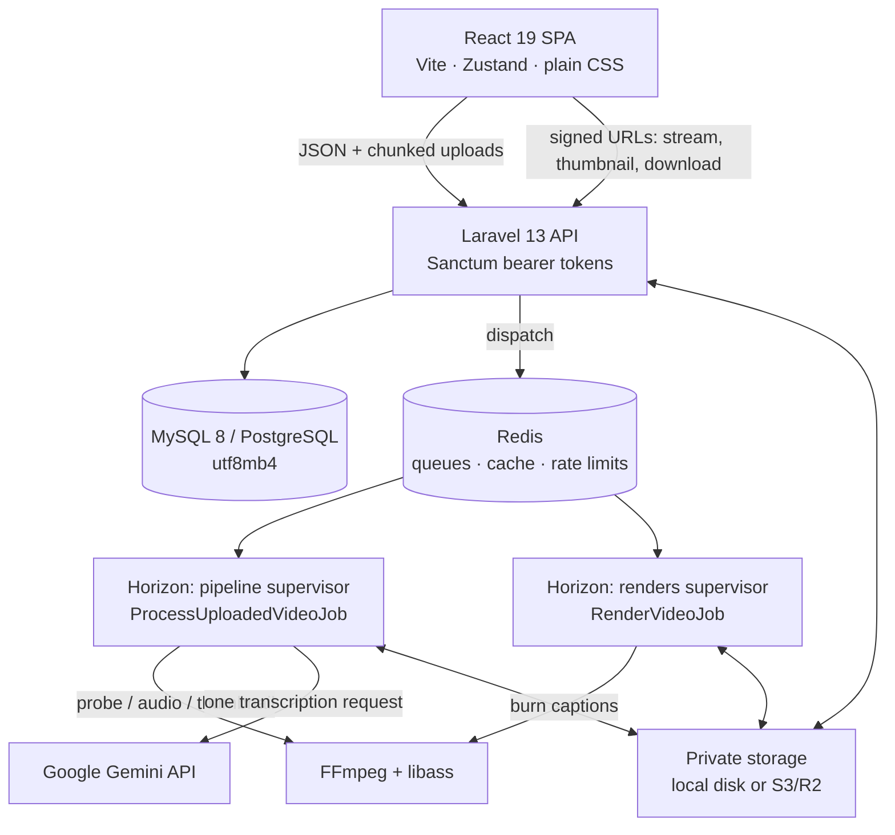
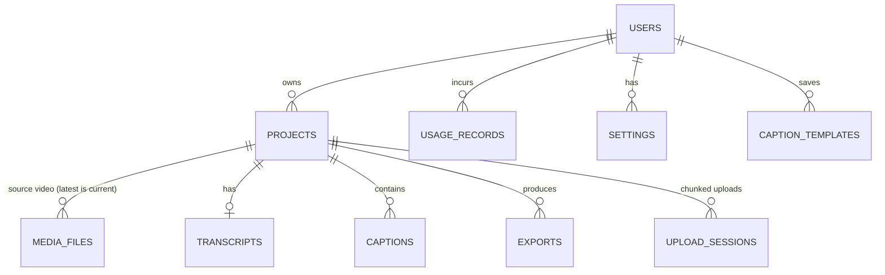

# Architecture

How SampleCap is put together, why, and where to extend it. For setup see [SETUP.md](SETUP.md); for the HTTP contract see [API.md](API.md).

---

## 1. Overview



**Request path:** the SPA talks only to `/api/*` with `Authorization: Bearer <token>`. Media never leaves private storage directly — the API issues short-lived signed URLs that `<video>`, `` and `<a download>` can use without a token.

**Background work:** everything slow (FFmpeg, Gemini, MP4 encoding) runs on queues. Two Horizon supervisors keep long renders from blocking captioning.

---

## 2. Branding (single source per app)

| Where | Source of truth | How to rename |
|---|---|---|
| Web app | `frontend/src/config/brand.ts`, read from `VITE_BRAND_*` env | `VITE_BRAND_NAME=පේළිCap` in `frontend/.env`, rebuild |
| `index.html` title/description | `%VITE_BRAND_NAME%` placeholders (defaults in `vite.config.ts`) | same variable |
| API, rendered files | `backend/config/brand.php`, read from `BRAND_*` env | `BRAND_NAME=පේළිCap` in `backend/.env`, `php artisan config:cache` |

No component hard-codes the name: UI uses `useBrand()` / `BRAND`, the document title uses `useDocumentTitle()`, the backend uses `config('brand.name')` (also written into generated ASS subtitle headers). `GET /api/brand` exposes the backend values. localStorage keys keep the internal `samplecap_` prefix on purpose — renaming must not log users out.

---

## 3. Backend layout

Controllers are thin: they authorise, validate and delegate.

```text
app/
├── Actions/                 single-purpose use cases (register, login, create/update/delete project)
├── Console/Commands/        captions:install-fonts, captions:sync-templates, uploads:prune, media:make-private
├── Exceptions/              UserFacingException (+ AIProvider, VideoProcessing, UsageLimitExceeded)
├── Http/
│   ├── Controllers/Api/     Auth, Account, Settings, Usage, Dashboard, Project, VideoUpload,
│   │                        UploadSession, Caption, CaptionTemplate, Export, MediaStream, Brand
│   ├── Middleware/          AssignRequestId, SecurityHeaders, HorizonBasicAuth
│   ├── Requests/            FormRequests (auth, projects, exports)
│   └── Resources/           JSON shapes — never expose storage paths
├── Jobs/                    ProcessUploadedVideoJob (pipeline), RenderVideoJob (MP4)
├── Models/                  User, Project, MediaFile, Transcript, Caption, CaptionTemplate,
│                            Export, UploadSession, UsageRecord, Setting
├── Policies/                Project, Caption, Export, CaptionTemplate, UploadSession
├── Rules/JsonSize.php       caps JSON columns
├── Services/
│   ├── AI/                  AIProviderInterface, GeminiAIProvider, FakeAIProvider, SegmentNormalizer, WordTimingEstimator
│   ├── Caption/             SubtitleFormatterService, CaptionStyleNormalizer, SinhalaTextNormalizerService
│   ├── Export/ExportService.php
│   ├── Media/               MediaStorage (local/S3 abstraction), MediaIngestService
│   ├── Rendering/           AssCaptionRenderer, VideoRendererService, FontRegistry, ProcessRunner, …
│   ├── Usage/UsageService.php
│   └── Video/FFmpegService.php
└── Support/AppLog.php       structured JSON logging with redaction
```

### Response envelope
Every response is `{ success, message, data }`. Errors add `code`, `request_id` and, for validation, `errors`:

```json
{ "success": false, "message": "This would exceed your 120 caption minutes for this month.",
  "data": {}, "code": "usage_limit_exceeded", "request_id": "6b1c…" }
```

Rendering lives in `bootstrap/app.php`. `UserFacingException` messages are shown as-is; any other exception becomes a generic 500 message (details only in logs, and in the message only when `APP_DEBUG=true` outside production).

---

## 4. Data model

All public identifiers are UUIDs (route keys); numeric ids are internal.



| Table | Key columns |
|---|---|
| `users` | `uuid`, `role` (`user`/`admin`), `plan` (`free`/`pro`/`unlimited`) — neither is mass-assignable |
| `projects` | `status` (see §5), `processing_error` (user-safe), `language`, probed `duration/width/height/fps`, `thumbnail` (storage key), `settings.editor` (editor style/canvas) |
| `media_files` | `disk`, `file_path` (random name), `audio_path`, `mime_type` (detected), `file_size`, probe `metadata` |
| `captions` | `uuid` (client-generated in the editor), `sequence`, `start_time`, `end_time`, `text`, `language`, `style_override`, `metadata.words` |
| `exports` | `type`, `status`, `progress`, `file_path` (hidden), `metadata` (options + style snapshot) |
| `upload_sessions` | `file_size`, `chunk_size`, `total_chunks`, `received_chunks`, `status`, `expires_at` |
| `usage_records` | `action`, `quantity`, `unit`, `metadata` — an append-only ledger |

Indexes cover the hot queries: `(user_id, status)`, `(user_id, created_at)` on projects; `(project_id, sequence)` on captions; `(user_id, type, status)` on exports; `(user_id, action, created_at)` on usage.

---

## 5. Processing pipeline

`ProcessUploadedVideoJob` (queue `default`, unique per project, `tries = 1` so a retry never repeats a paid AI call):

| Status | Step |
|---|---|
| `uploaded` | queued |
| `processing` | FFprobe → duration, size (rotation-aware), fps, audio present? Plan check on duration. Thumbnail (best effort). |
| `extracting_audio` | FFmpeg → 16 kHz mono MP3, stored next to the video |
| `transcribing` | `FallbackTranscriber`: **Gemini 3.5 Transcribe** (`GEMINI_TRANSCRIBE_MODEL`) → word timestamps (+ speakers) → `CaptionLineBuilder` lines. Falls back to the text model if the speech model is unavailable/overloaded/returns no timings. Audio longer than `GEMINI_TRANSCRIBE_CHUNK_SECONDS` is split and re-offset. One `ai_request` per call |
| `generating_captions` | **Gemini 3.8 Flash** (`GEMINI_TEXT_MODEL`) cleans punctuation/spacing/Unicode line-by-line (`GeminiCaptionRefiner`; rejects rewrites/translations, never touches timing). Transcript row keeps the **original** text + timings; each caption keeps `metadata.original_text`, `cleaned`, `speaker`, `source`. Bulk insert; `caption_generation` seconds recorded |
| `ready` | done |
| `failed` | `processing_error` holds a safe reason ("This video has no audio track…") |

The job works on a **local copy** (`MediaStorage::withLocalCopy`) so the media disk can be S3. Failures are logged as `pipeline.failed` / `pipeline.crashed` with the project id and technical context.

### AI provider
- **Bring your own key.** Each user saves their own Google AI key on Account & usage (created at https://aistudio.google.com/app/api-keys). `AiKeyController` checks it with Google (`GeminiKeyVerifier` fetches the configured model — free, and proves the key can use that model) before storing it with Eloquent's `encrypted` cast; only the last 4 characters are ever returned. `AIProviderFactory::forUser()` builds a Gemini provider with the project owner's key. Uploads and regeneration are refused up front (`422 ai_key_required`) when the user has no usable key. If Google rejects the key during processing, the project fails with a pointer to Account & usage and the key is marked `invalid`. `AI_ALLOW_SERVER_KEY=true` lets keyless users fall back to the server's `GEMINI_API_KEY`.
- `GeminiAIProvider`: API key in the `x-goog-api-key` header (never in URLs), inline audio up to `GEMINI_INLINE_MAX_BYTES`, otherwise the Gemini **Files API** (streamed resumable upload, deleted afterwards). JSON response schema enforced; retries 408/429/5xx with backoff; safety blocks, truncated output and malformed JSON all raise `AIProviderException`. It **never** invents captions.
- **Language handling:** `en` → `en-US` hint; `si` → `si-LK` hint, retried with auto-detect if refused (Sinhala is not on Gemini 3.5 Transcribe's published list — the text-model fallback covers it); `auto` → auto-detect, including Sinhala-English code-switching. Line language is derived from script (Sinhala block → `si`).
- **Human review:** AI output is never assumed correct — every caption is editable; the editor labels AI captions for review and offers *Restore original* while a caption still maps 1:1 to a transcribed line (split/merge drop the per-caption original; the transcript keeps it).
- `SegmentNormalizer` cleans output: drops empty and out-of-range lines, clamps to the media duration, sorts, removes overlaps, keeps Sinhala ZWJ conjuncts.
- `FakeAIProvider` returns clearly-labelled sample lines. Used when `AI_PROVIDER=fake`, or when no key is set **outside production**. Tests force it (`phpunit.xml`) and block real HTTP (`Http::preventStrayRequests()`).

---

## 6. Frontend layout

```text
src/
├── App.tsx                  routes; every page is React.lazy (own chunk); global ToastContainer + ErrorBoundary
├── config/                  brand.ts (env-driven), constants.ts
├── components/              Button, Input, Modal (focus trap), ConfirmDialog, Dropdown (menu button),
│                            Progress, LoadingState, EmptyState, ErrorState, RetryState, Tooltip, Toast,
│                            ShortcutsDialog, ErrorBoundary, Skeleton, Badge
├── features/
│   ├── editor/              studio editor (see §8)
│   └── projects/            ProjectCard, ProcessingSteps
├── hooks/                   useBrand, useDocumentTitle, useProjectStatus (polling with backoff)
├── layouts/                 AppLayout (sidebar drawer on ≤900px, skip link, "?" help), AuthLayout
├── pages/                   Landing, Login, Register, Dashboard, Projects, CreateProject,
│                            ProjectDetails, Settings, Profile, NotFound, Editor
├── services/                api (axios + global error policy), errors (toAppError), uploadService
│                            (ChunkedUpload), project/caption/export/account services
├── stores/                  auth, project, usage, settings, toast, theme (+ editor stores)
└── utils/                   formatters, storage (safe localStorage), video, validation, navigation
```

**Error policy (`services/api.ts`):** 401 → clear session, redirect to `/login?next=…` once; 422 → left to forms (inline field errors via `toAppError().fieldErrors`); everything else → one friendly toast (deduplicated). Requests that show their own UI pass `{ silent: true }` (autosave, uploads, status polling). 5xx messages are replaced by friendly copy plus a short request reference.

**State:** small Zustand stores; pages that are URL-addressable keep filters in the URL (`/projects?status=ready&search=…&page=2`).

---

## 7. Responsive & accessible UI

- Breakpoints: ≤1024 px tighter gutters, ≤900 px sidebar becomes an off-canvas drawer, ≤600 px single-column forms. The editor targets desktop and has its own tablet/mobile layouts (§8).
- Semantics: one `h1` per page, landmark `nav`/`main`, skip link, `fieldset/legend` radio groups, labelled inputs with `aria-invalid` + `aria-describedby`, `role="progressbar"` with value text, `role="alert"` for errors, polite live regions for status.
- Keyboard: every action reachable; Modal traps and restores focus (stacked dialogs handled), Dropdown follows the WAI-ARIA menu-button pattern, `⌘/Ctrl+K` search, `?` shortcuts dialog.
- Not colour-only: statuses carry icon + text; `prefers-reduced-motion` disables animation.

---

## 8. Browser Caption Editor (STEP 3)

Route: `/projects/:uuid/editor` (lazy-loaded). Code lives in `frontend/src/features/editor/` and `frontend/src/stores/editor/`.

### State — six small stores, no god object

| Store | Owns | Notes |
|---|---|---|
| `editorProjectStore` | project uuid/name, base `settings`, load + save status | Save status: `saved · saving · unsaved · failed · offline` |
| `videoStore` | currentTime, duration, play state, volume, rate, captions visibility | Written only by `services/playback.ts` |
| `captionStore` | **the document** (`captions`, `style`, `customPresets`, `canvas`) + undo/redo history | Everything persisted and undoable lives here |
| `timelineStore` | zoom (px/s), snapping, overlap prevention, follow-playhead, drag feedback | |
| `editorStore` | selection, active tool, style scope (all vs one caption), nudge step | |
| `uiStore` | preview mode, dialogs, tablet drawers, mobile tab | |

`currentTime` updates every animation frame while playing. Components never subscribe to it directly unless they must:
the playhead and clocks write to the DOM from a store subscription, and `useActiveCaptionId()` re-renders only when the *active caption* changes.

### History
Whole-document snapshots with structural sharing (cheap). `commit()` = one entry; `coalesceKey` merges bursts (typing in one caption, scrubbing one slider, repeated nudges) within 1 s; `beginTransaction/endTransaction` wraps drags so a drag is one undo step. Undo restores the selection too.

### Persistence
`services/autosave.ts` debounces 800 ms after the last change (never during a drag), sends only dirty parts, never overlaps saves, retries with backoff, and blocks tab close while unsaved.
- Captions → `PUT /projects/{uuid}/captions/sync`. Caption ids are **client-generated UUIDs** and double as the DB `uuid`; sync restores soft-deleted rows so undoing a delete works.
- Style, custom presets, canvas → `PATCH /projects/{uuid}` as `settings.editor` (merged with existing settings; `version: 2`).
- Per-caption overrides → `captions.style_override`. `captions.metadata.editor_version = 2` marks data written by this editor; older overrides are migrated on load (`sanitizeStyle(..., legacy)`).

### Rendering contract for STEP 4 (export)
- Style pixel values (`fontSize`, `padding`, `outlineWidth`, shadow, radius) are in **1080p reference units**: relative to a frame whose *short side* is 1080 px. Preview scales by `min(w,h)/1080`; a renderer should do the same.
- `positionX/positionY` are anchor percentages of the frame; `alignMatrix` decides which corner/edge of the text box sits on the anchor. `maxWidth` is % of frame width.
- Stroke is drawn *outside* the glyphs (outline layer under a fill layer). Shadow belongs to the outline layer.
- `canvas.aspect` (`source | 16:9 | 9:16 | 1:1 | 4:5`) is the output frame; video is letterboxed (`contain`).
- Timed animations (`karaoke`, `highlight`, `typewriter`) use `words[]` timings when present, otherwise `getWordTimings()` estimates them by token length.
- Use `features/editor/services/serialization.ts` + `utils/captionStyle.ts` from the exporter so preview and export cannot drift.

### Unicode / Sinhala
Text is NFC-normalised (ZWJ/ZWNJ preserved). `splitGraphemes()` keeps Sinhala syllables and ZWJ conjuncts (ශ්‍රී, ක්‍ෂ) intact for splitting and the typewriter effect. Fonts: a Latin font first in the stack, then a Sinhala font, so mixed-script captions render each script in its own face. Shortcuts ignore keys during IME composition.

---

## 9. Styling, Templates & Export (STEP 4)

### Style model & presets
- One style object (see §8) is shared by the editor preview, saved templates and the MP4 renderer. The backend validates it with `App\Services\Caption\CaptionStyleNormalizer` (twin of the editor's `sanitizeStyle`).
- The 8 built-in presets (Spotlight — the default: white text with the spoken word highlighted yellow via `karaoke` + `highlightColor` — Modern, Bold, Minimal, Cinema, YouTube, TikTok, Classic) are structured configuration in **`presets.json`**, kept in two identical copies: `frontend/src/features/editor/model/presets.json` (editor) and `backend/resources/captions/presets.json` (system templates). A backend test fails if they drift.

### Templates (`caption_templates`)
| Column | Notes |
|---|---|
| `uuid`, `user_id` (NULL = system), `slug` | System templates are keyed by preset slug |
| `name`, `description`, `category`, `preview_text`, `sort_order` | |
| `is_system` | Read-only for users |
| `style` (JSON) | Full style: font, size, weight, italic, colours, stroke, shadow, background, padding, radius, alignment, position, animation |

API: `GET/POST /api/caption-templates`, `DELETE /api/caption-templates/{uuid}`. System templates are synced from `presets.json` (`php artisan captions:sync-templates`, also run by the seeder and on first listing). Applying a **system** template changes only the look; a **user** template also carries its layout.

### Exports
`exports`: `uuid, project_id, user_id, type (srt|vtt|txt|json|mp4), status (queued|processing|completed|failed), progress, file_path, file_size, error_message, metadata, started_at, completed_at`.

| Endpoint | |
|---|---|
| `POST /api/projects/{project}/exports` | `{type, resolution?: 720\|1080\|2160\|source, quality?: high\|standard\|small, template?: uuid}` |
| `GET /api/projects/{project}/exports` | Latest 50 |
| `GET /api/exports/{export}` | Status/progress + short-lived `download_url` when completed |
| `DELETE /api/exports/{export}` | Deletes the file; cancels a running render |
| `GET /api/exports/{export}/download` | **Signed URL only** (30 min); never exposes storage paths |

- Text formats are generated immediately by `SubtitleFormatterService` (UTF-8, NFC; SRT skips empty cues and never prints `,1000` ms; VTT escapes `& < >`).
- MP4: `ExportService` snapshots the style and queues **`RenderVideoJob`** (never rendered in the HTTP request). Pipeline: captions → `AssCaptionRenderer` (ASS script) → `VideoRendererService` (FFmpeg + libass) → private disk → export record. Max 2 active renders per user. 4K is only offered when the source's short side ≥ 2160.
- Files live on the **private** `local` disk (`exports/{project}/{export}.{ext}`); downloads use `URL::temporarySignedRoute`.
- The editor's source video is also served through a signed, Range-capable stream (`GET /api/media/{uuid}/stream`), so seeking works even on `php artisan serve` (which cannot serve byte ranges).

### Rendering (FFmpeg)
- **Requirements:** FFmpeg with **libass ≥ 0.17** + HarfBuzz (`brew install ffmpeg-full` on macOS; `apt install ffmpeg` on Debian 12 / Ubuntu 24.04), and caption fonts installed with `php artisan captions:install-fonts` (static TTFs into `storage/app/fonts`).
- `AssCaptionRenderer` mirrors the preview: 1080p reference units scaled by `min(W,H)/1080`; layers = background box (BorderStyle 4, one padded box) → shadow (offset + blur) → outlined text; font runs follow the CSS fallback of the stack `<English font>, <Sinhala font>` (only Sinhala-block chars + ZWJ/ZWNJ use the Sinhala font); each run uses the exact installed face (`FontRegistry` reads the TTF name table — libass ignores `\b600` on the base family) and a size corrected for the font's win ascent/descent; karaoke / word box / typewriter become timed events.
- `VideoRendererService` builds an argv array (no shell), prefixes paths with `file:`, escapes filtergraph values (`FilterEscaper`, both FFmpeg escaping levels), whitelists encoder values, parses `-progress` output and supports cancellation. Process execution sits behind `ProcessRunner` so tests can fake FFmpeg.
- **Known differences from the preview** (libass limits, marked "preview only" in the editor): rounded box corners and custom line height are not rendered.

### Operations
- Renders run on the `renders` queue (`RENDER_QUEUE`), captioning on `default`. Horizon runs both supervisors; see [DEPLOYMENT.md](DEPLOYMENT.md). **Restart workers after deploying** (`php artisan horizon:terminate` or `queue:restart`).
- Deleting a project removes its video, audio, thumbnail, exports and pending chunks from storage. Render inputs are read through `MediaStorage::withLocalCopy`, so S3 works. Concurrent renders and monthly renders are plan limits (§12).


---

## 10. Security model

| Concern | Implementation |
|---|---|
| Authentication | Sanctum personal access tokens (Bearer), expire after `SANCTUM_TOKEN_EXPIRATION` minutes (default 30 days), pruned daily. Password change revokes other tokens. Passwords: min 8, letters + numbers. |
| Authorization | Policies for Project, Caption, Export, CaptionTemplate, UploadSession. Caption routes use **scoped bindings** (a caption UUID is looked up inside the URL's project). Sync ignores caption UUIDs that belong to other projects. Covered by `CrossUserAuthorizationTest`. |
| Rate limiting | Named limiters in `AppServiceProvider`: `login` (5/min per email+IP, 20/min per IP), `register` (10/h/IP), `api` (240/min), `uploads`, `upload-chunks`, `ai` (20/h), `exports`, `autosave`, `polling`, `media`. 429 responses include `Retry-After`. |
| Validation | FormRequests / inline rules on every write; caption text ≤ 2000, ≤ 5000 captions per project, JSON columns capped (`JsonSize`), enums for language/status/resolution, LIKE wildcards escaped in search. Server-owned fields (status, duration, thumbnail, role, plan) are never accepted from clients. |
| Files | Extension allow-list **and** MIME detected from file bytes (libmagic); random UUID filenames under `media/{project}/`; original names sanitised for display only; chunk sizes verified exactly; no user input ever forms a path (no traversal). |
| Private storage | Videos, audio, thumbnails and exports live on the private disk. Clients get **temporary signed URLs** (stream 12 h, downloads 30 min) bound to one file. `media:make-private` migrates pre-STEP-5 public files. |
| XSS | React escapes output; API responses carry `Content-Security-Policy: default-src 'none'` and `nosniff`; downloads set explicit content types; subtitle/ASS writers escape markup and override tags. |
| CSRF | Not applicable: no cookie authentication (Sanctum stateful domains are empty, CORS `supports_credentials=false`). |
| CORS | Only `CORS_ALLOWED_ORIGINS`; limited methods/headers. |
| Headers | `X-Frame-Options: DENY`, `Referrer-Policy`, `Permissions-Policy`, HSTS on HTTPS, `X-Request-Id`. |
| User AI keys | Encrypted at rest with `APP_KEY`, `$hidden` on the model, only the last 4 characters leave the server, sent to Google only in a header, save/verify rate-limited (10/min). Rotating `APP_KEY` makes saved keys unreadable — users must re-enter them. |
| Secrets | Never logged: `AppLog` redacts keys/tokens/passwords/signatures and Google keys in any string. Gemini key travels in a header. Stack traces never reach clients. |
| Queues | Jobs carry model ids only (SerializesModels); Horizon dashboard requires HTTP Basic credentials outside local. |

## 11. Uploads (chunked & resumable)

```
POST /projects/{p}/uploads  {file_name, file_size}   → session {uuid, chunk_size, total_chunks, received_chunks}
PUT  /uploads/{u}/chunks/{i}   raw bytes (exact size)  → idempotent
GET  /uploads/{u}                                       → received_chunks (resume)
POST /uploads/{u}/complete                              → assemble, MIME check, store, start pipeline
DELETE /uploads/{u}                                     → cancel
```

- The browser (`ChunkedUpload`) reads with `Blob.slice` (never the whole file in memory), sends 3 chunks in parallel, retries each with exponential backoff, waits for `online` when offline, shows speed/ETA, and can cancel. Starting the same file again **resumes** (matched by name + size).
- Chunks stream to `storage/app/chunks/{uuid}` (`stream_copy_to_stream`, written to a temp name then renamed). Parallel acknowledgements are serialised with a cache lock.
- Chunk size defaults to 5 MB (`UPLOAD_CHUNK_SIZE`) — keep it under PHP `post_max_size`. Abandoned sessions and scratch files are removed hourly by `uploads:prune`.
- `POST /projects/{p}/upload` (single request) remains for small files and API clients.

## 12. Usage tracking & limits (AI cost control)

- **Ledger:** `UsageService::record()` appends `usage_records`: `ai_request` (count + provider/model/tokens), `caption_generation` (seconds), `export` (count + type), `video_render` (seconds), `upload` (bytes). Storage is computed live from media + export sizes.
- **Plans:** `config/plans.php` (`free`, `pro`, `unlimited`; `null` = unlimited). `users.plan` selects one. Limits: caption minutes/month, AI requests/day, exports/month, renders/month, storage, max upload size, max video length, concurrent renders.
- **Enforcement points:** upload start (size, storage, minutes left), pipeline after probing (video length, minutes), before the AI call (daily requests), regenerate, export create. Violations throw `UsageLimitExceededException` → HTTP **402** with `code: usage_limit_exceeded`.
- **Reporting:** `GET /api/usage`; also embedded in `GET /api/dashboard`. Summaries are cached 5 minutes per user and invalidated on every write.
- **Subscriptions later:** a billing integration only sets `users.plan` (e.g. from a webhook) — no other code changes.

## 13. Errors & logging

- **Backend:** user-caused problems are `UserFacingException` subclasses carrying a safe message + private `context`. Everything else is reported (`report()`) and shown as a generic message.
- **Structured log:** `App\Support\AppLog` writes JSON lines to `storage/logs/events-YYYY-MM-DD.log` (`LOG_STRUCTURED_CHANNEL`). Every entry includes `request_id` (and `user`) via Laravel `Context`, which also propagates into queued jobs. Events: `auth.login`, `auth.login_failed` (email hashed), `auth.access_denied`, `auth.password_changed`, `upload.started|completed|rejected_mime|cancelled|size_mismatch`, `pipeline.started|completed|failed|crashed`, `ai.request_failed|invalid_response|connection_failed`, `ffmpeg.probe_failed|extract_audio_failed|timeout|unavailable`, `export.completed`, `render.queued|completed|failed|crashed|cancelled`, `queue.job_failed`.
- **Frontend:** `ErrorBoundary` per route, global toast policy (§6), reusable `ErrorState` / `RetryState` / `EmptyState` / `LoadingState`.

## 14. Performance notes

- No N+1: lists eager-load `primaryMediaFile`; status counts come from one grouped query.
- Captions from AI are bulk-inserted; old ones force-deleted in the same transaction.
- Editor: per-frame time updates bypass React (§8); caption lists virtualised; project details page renders the first 300 captions with `content-visibility: auto`.
- Code splitting: every route is a lazy chunk; vendor/react/icons split for long-term caching.
- Polling backs off on errors and pauses in hidden tabs.

## 15. Extension points (not built yet, by design)

| Future feature | Where it plugs in |
|---|---|
| Subscriptions / payments | set `users.plan`; add plans in `config/plans.php`; read `GET /usage` |
| More AI / transcription providers | implement `AIProviderInterface`, choose via `AI_PROVIDER` in `AppServiceProvider` |
| Caption translation / AI rewriting | new methods on a provider + a job that writes captions through the same transaction as the pipeline |
| Cloud storage | set `MEDIA_DISK`/`EXPORT_DISK` to an S3-compatible disk (already supported) |
| Team collaboration | add `team_id` to projects; widen the policies (they are the only ownership checks) |
| Caption templates / social presets | `caption_templates` + `presets.json`; canvas aspect presets already exist |
| Admin dashboard / analytics | `users.role = admin`, `usage_records` ledger, structured event log |
| Mobile app | the API is token-based and versionable; signed media URLs work in native players |
