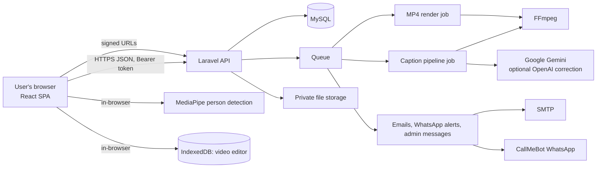

# Sinsub (සිංSub) — Software Requirements Specification

| | |
|---|---|
| **Product** | Sinsub (සිංSub): Sinhala & English video captions, subtitles and video editor |
| **Live address** | https://sinsub.cc (planned main domain: sinsub.lk) |
| **API** | https://captionapi.cloudshift.lk/api |
| **Document version** | 1.0 — 28 November 2026 |
| **Status** | Describes the system as built in the repository on this date |
| **Related documents** | [ARCHITECTURE.md](ARCHITECTURE.md) · [API.md](API.md) · [SETUP.md](SETUP.md) · [ENVIRONMENT.md](ENVIRONMENT.md) · [DEPLOYMENT.md](DEPLOYMENT.md) · [TROUBLESHOOTING.md](TROUBLESHOOTING.md) |

---

## Contents

1. [Introduction](#1-introduction)
2. [Overall description](#2-overall-description)
3. [Plans, limits and pricing](#3-plans-limits-and-pricing)
4. [Functional requirements and scenarios](#4-functional-requirements-and-scenarios)
   - 4.1 [Accounts and sign-in](#41-accounts-and-sign-in)
   - 4.2 [Onboarding: welcome and app tour](#42-onboarding-welcome-and-app-tour)
   - 4.3 [Dashboard](#43-dashboard)
   - 4.4 [Caption projects: upload and AI captioning](#44-caption-projects-upload-and-ai-captioning)
   - 4.5 [Caption editor (studio)](#45-caption-editor-studio)
   - 4.6 [Caption styles and templates](#46-caption-styles-and-templates)
   - 4.7 [Captions behind the person (Pro)](#47-captions-behind-the-person-pro)
   - 4.8 [Exports: subtitle files and MP4](#48-exports-subtitle-files-and-mp4)
   - 4.9 [Video editor](#49-video-editor)
   - 4.10 [Video editor projects: account and project files](#410-video-editor-projects-account-and-project-files)
   - 4.11 [Usage and limits](#411-usage-and-limits)
   - 4.12 [Billing: Pro by bank transfer](#412-billing-pro-by-bank-transfer)
   - 4.13 [Free Pro trial](#413-free-pro-trial)
   - 4.14 [Notifications](#414-notifications)
   - 4.15 [Settings and account](#415-settings-and-account)
   - 4.16 [Reviews](#416-reviews)
   - 4.17 [Administration](#417-administration)
   - 4.18 [Marketing and sign-up attribution](#418-marketing-and-sign-up-attribution)
   - 4.19 [Public website and SEO](#419-public-website-and-seo)
5. [External interface requirements](#5-external-interface-requirements)
6. [Non-functional requirements](#6-non-functional-requirements)
7. [Data requirements](#7-data-requirements)
8. [Background processing and scheduled tasks](#8-background-processing-and-scheduled-tasks)
9. [Deployment and configuration](#9-deployment-and-configuration)
10. [Known limitations and open items](#10-known-limitations-and-open-items)
11. [Appendices](#11-appendices)

---

## 1. Introduction

### 1.1 Purpose

This document specifies what Sinsub does: every feature, who can use it, the rules and limits that apply, and how the system behaves in normal and exceptional situations. It is written for the people who build, test, operate and decide on the product. It is the reference for checking whether a change is a bug (the system does not match this document) or a new requirement (the document must change).

### 1.2 Scope

Sinsub is a web application for Sri Lankan creators. It:

- writes **Sinhala, English and mixed Sinhala-English captions** for a video with AI, timed word by word;
- lets the user **edit, style and position** the captions in a studio editor;
- **exports** subtitle files (SRT, VTT, TXT, JSON) and **MP4 videos with burned-in captions** (up to 4K);
- includes a **multi-track video editor** in the browser (cutting, text, music, filters, subtitles, AI voice-over and more);
- sells a **Pro** plan by bank transfer, with a **7-day free trial**;
- gives the owner an **admin area**: users, payments, reviews, notifications and marketing links.

Out of scope: card payments, mobile apps, team accounts, live streaming captions, and server-side video editing of video-editor projects.

### 1.3 Definitions

| Term | Meaning |
|---|---|
| **Caption project** | A video uploaded for AI captioning, with its captions, style and exports. Lives on the server. |
| **Caption editor / studio** | The editor for a caption project (`/projects/{uuid}/editor`). |
| **Video editor** | The multi-track browser editor (`/video-editor`). Its media stays on the user's device. |
| **Video editor project** | A video editor timeline. Saved in the browser, optionally to the account (layout only) and as a `.sinsub` project file. |
| **Plan** | Free, Pro or Unlimited (admin-only). Defines limits and features. |
| **Usage cycle** | A 30-day period after which monthly limits reset, counted from sign-up or from when the current plan started. |
| **Render** | Making an MP4 with burned-in captions on the server (FFmpeg + libass). |
| **Trial** | 7 days of Pro, once per email, for Free accounts that never paid. |
| **Admin** | A user with `role = admin`. |
| **Layout** | A video editor project without its media files: tracks, clips, text, effects, file names. |
| **Subject mask** | The outline of the person in each video frame, used to draw captions behind them. |

### 1.4 Requirement notation

Requirements have identifiers such as **FR-CAP-03** (functional) and **NFR-SEC-02** (non-functional). "Must" is mandatory; "should" is expected unless there is a good reason. Scenarios list a main flow and the exceptional flows the system handles.

---

## 2. Overall description

### 2.1 Product perspective

- **Frontend:** React 19 single-page app (Vite, Zustand, plain CSS), hosted on Hostinger as static files. Public pages are prerendered to HTML for search engines.
- **Backend:** Laravel 13 (PHP 8.5) JSON API with Sanctum bearer tokens, MySQL, a database queue (Redis/Horizon supported), FFmpeg with libass for rendering.
- **AI:** Google Gemini for transcription and text tools (per-user key or the server key), optional OpenAI caption correction, Gemini text-to-speech for voice-over.
- **In the browser:** the video editor draws, previews and exports entirely in the browser. MediaPipe finds the person for "behind the person" captions.

### 2.2 User classes

| Class | Description | Access |
|---|---|---|
| **Visitor** | Not signed in. Reads the public site, pricing and guides. | Public pages, sign-up, sign-in |
| **Free user** | Signed-up account on the Free plan. | All core features within Free limits |
| **Trial user** | Free user on the 7-day Pro trial. | Pro features until the trial ends |
| **Pro user** | Paid for Pro (30 days or 1 year). | Pro limits and features |
| **Unlimited user** | Special accounts set by an admin. Never sold. | No limits, all features |
| **Admin** | Owner/staff (`role = admin`). Any plan. | Admin area in addition to their own account |

### 2.3 Operating environment

- **Browsers:** current Chrome, Edge, Safari and Firefox on desktop. Phones and tablets can use the site; the video editor recommends a tablet or computer.
- **Video editor export and person detection:** need `MediaRecorder`, `canvas.captureStream`, WebAssembly and WebGL (best in Chrome/Edge).
- **Server:** PHP 8.5, MySQL 8, FFmpeg with libass, a queue worker and the Laravel scheduler (cron every minute).

### 2.4 Design and implementation constraints

- The product name comes from configuration (`VITE_BRAND_*`, `BRAND_*`); no screen hard-codes it.
- Plan limits are defined once in `backend/config/plans.php` and mirrored for display in `frontend/src/config/pricing.ts`; both must change together.
- Prices are in LKR (`backend/config/billing.php`).
- Payments are manual (bank transfer, checked by an admin). There is no card gateway.
- Video editor media never leaves the device unless the user downloads a project file.

### 2.5 Assumptions and dependencies

- A Google AI key is available (the user's own or the server's), otherwise captioning cannot run in production.
- Email (SMTP) is configured for password resets, payment and plan emails, and admin message emails.
- The queue worker and scheduler run continuously.
- The owner's WhatsApp number is 075 517 3298 (configurable).

---

## 3. Plans, limits and pricing

### 3.1 Plan matrix

Source of truth: `backend/config/plans.php`. `null` means no limit.

| | **Free** | **Pro** | **Unlimited** (admin-given) |
|---|---|---|---|
| Price | Free | LKR 490 / 30 days · LKR 3,990 / year | Not sold |
| Caption minutes per cycle | 15 | 600 | No limit |
| MP4 renders per cycle | 5 | 300 | No limit |
| Subtitle exports per cycle | 50 | No limit | No limit |
| AI requests per day | 10 | 300 | No limit |
| Longest video | 3 min | 3 h | No limit |
| Largest upload | 200 MB | 4 GB | 8 GB |
| Storage | 1 GB | 50 GB | No limit |
| Renders at the same time | 1 | 3 | 6 |
| Video editor projects saved online | 5 | 200 | No limit |
| MP4 resolution | Up to 720p | Up to 4K | Up to 4K |
| Watermark on MP4 | Yes (සිංSub) | No | No |
| Caption styles | 4 basic: Bold, Modern, Minimal, Classic | All | All |
| Word-by-word highlight / karaoke animations | No | Yes | Yes |
| Captions behind the person | No | Yes | Yes |
| Video editor AI tools (voice-over, translate, script, titles, highlights) | No | Yes | Yes |
| Auto subtitles and Singlish typing in the video editor | Yes | Yes | Yes |
| WhatsApp support | Yes | Priority | Priority |

Pro-only styles: Spotlight, Hormozi, Word Box, TikTok (highlight animations) and Cinema, YouTube (Pro presets).

### 3.2 Rules

- **FR-PLAN-01** The plan in force is `users.plan`, except that a paid plan past `plan_expires_at` counts as Free.
- **FR-PLAN-02** Monthly limits apply per **30-day usage cycle**, counted from sign-up or from when a new plan was switched on (`plan_started_at`). After a paid plan ends, the cycle counts from its end date. Renewing the same plan keeps the cycle.
- **FR-PLAN-03** Monthly Pro lasts 30 days, yearly Pro one calendar year. Paying before the current period ends adds the new time after it.
- **FR-PLAN-04** Limits are checked on the server before the action (upload, captioning, export, render, AI call). Exceeding a limit returns HTTP 402 with code `usage_limit_exceeded` and a message the app shows as "available on Pro".
- **FR-PLAN-05** An admin can reset a user's usage for the current cycle; usage before the reset stops counting, but the records are kept.

---

## 4. Functional requirements and scenarios

### 4.1 Accounts and sign-in

**Requirements**

- **FR-AUTH-01** Users register with name, email and password (min 8 characters with letters and numbers). An optional WhatsApp number with consent can be given.
- **FR-AUTH-02** Users can sign in with **Google** ("Continue with Google"). A Google account with the email of an existing account is linked to it.
- **FR-AUTH-03** Sign-in returns an API token. Tokens expire after 30 days (`SANCTUM_TOKEN_EXPIRATION`) and are pruned daily.
- **FR-AUTH-04** Each sign-in records the device: browser, OS, IP, sign-in method, and a random **device id** the browser keeps. Signing in again on the same device **replaces** that device's previous session instead of adding a new one.
- **FR-AUTH-05** Forgot password sends a reset link by email; the answer is the same whether or not the email exists.
- **FR-AUTH-06** Sign-up records where the user came from (UTM tags or referring site, first visit within 90 days).
- **FR-AUTH-07** New accounts get a welcome notification and the app tour on their first visit.

**Scenario UC-AUTH-1: Register with email**

1. Visitor opens `/register`, enters name, email, password, confirmation, and optionally a WhatsApp number with "Send me updates on WhatsApp".
2. The system validates and creates the account on the Free plan, stores sign-up attribution, issues a token, sends the welcome notification and marks the tour pending.
3. The user lands on the dashboard; the tour starts.

*Exceptions:* email already used → inline error; weak password → inline error; invalid WhatsApp number → "Enter a WhatsApp number like 077 123 4567"; more than 10 registrations per hour from one IP → rate-limited.

**Scenario UC-AUTH-2: Sign in again on the same browser**

1. User signs in on a browser they used before.
2. The system deletes that browser's earlier session (matched by device id; for older sessions by the same browser and IP) and creates a new one.
3. Settings → Signed-in devices shows one entry for this browser with the new time.

*Exception:* other tabs still using the old session are signed out.

**Scenario UC-AUTH-3: Forgot password** — user enters email → generic confirmation → email with link → `/reset-password` sets a new password (rate-limited).

### 4.2 Onboarding: welcome and app tour

- **FR-ONB-01** New accounts (email or Google) receive the in-app notification "Welcome to සිංSub! 👋" linking to *New project*.
- **FR-ONB-02** The **app tour** starts automatically once for new accounts (`settings.tour_pending`). Existing accounts are not interrupted.
- **FR-ONB-03** The tour has 9 steps highlighting New project, Projects, search, plan usage, Upgrade, notifications, help. Steps whose element is hidden (e.g. sidebar on phones) show in the middle of the screen.
- **FR-ONB-04** Back / Next / Skip, arrow keys and Esc work. Finishing or skipping clears `tour_pending`.
- **FR-ONB-05** Anyone can replay it from the account menu → *Take the tour*.

### 4.3 Dashboard

- **FR-DASH-01** Shows a greeting, *New project*, tool cards (Auto captions, video editor and others), recent projects, and plan usage.
- **FR-DASH-02** Shows the **trial notice** (see 4.13) and the AI key notice when relevant.
- **FR-DASH-03** The sidebar card shows the plan, caption minutes used of the limit, the reset date, and the Pro or trial end date.

### 4.4 Caption projects: upload and AI captioning

**Requirements**

- **FR-CAP-01** The user creates a project (name, language: Sinhala, English or auto/mixed; optional script and vocabulary to improve spelling of names and terms).
- **FR-CAP-02** Videos upload in **resumable chunks**; an interrupted upload continues where it stopped. Size and length are checked against the plan.
- **FR-CAP-03** After upload, a background job runs: probe (duration, size, fps) → extract audio → transcribe with Gemini (word timings) → build caption lines → optional OpenAI correction → ready.
- **FR-CAP-04** The project page shows each step and progress; a small game arcade is offered while waiting.
- **FR-CAP-05** Caption minutes are charged for the video's length; the job never repeats a paid AI call on retry.
- **FR-CAP-06** If processing fails, the project shows a user-safe reason and can be regenerated. Projects stuck in processing are reset every 10 minutes.
- **FR-CAP-07** New projects of users without Pro styles start on the free "Bold" style.
- **FR-CAP-08** Users can delete a project; its files (video, audio, thumbnail, exports, upload chunks) are removed.

**Scenario UC-CAP-1: Caption a video**

1. User → *New project* → name, language → uploads a 2-minute MP4.
2. Upload goes in chunks with a progress bar; the server checks plan limits (Free: ≤ 200 MB, ≤ 3 min, minutes left).
3. Pipeline runs; the page moves through *Processing → Extracting audio → Transcribing → Ready*.
4. User opens the editor.

*Exceptions:*
- Video longer than the plan allows → 402 "Videos on your plan can be up to 3 minutes long."
- Not enough caption minutes left → 402 "This would exceed your 15 caption minutes for this month."
- No usable AI key (when the server key is off) → 422 `ai_key_required`, pointing to Account & usage.
- Google rejects the key during processing → project fails; the key is marked invalid.
- Network drop during upload → resumes from the last chunk.

### 4.5 Caption editor (studio)

- **FR-ED-01** Caption list with search; a timeline with a caption track, zoom and snapping; player with play/seek/volume.
- **FR-ED-02** Edit text and timing (drag the edges, arrow-key nudge), split, merge, add and delete captions. Undo/redo.
- **FR-ED-03** *Import captions:* paste a script or subtitles and either *Match speech* (aligned to the audio) or *Instant*, replacing or keeping existing captions.
- **FR-ED-04** Singlish typing converts Latin-letter Sinhala to Sinhala script. *AI original* shows what the AI first wrote; *Restore original* is available while a caption maps 1:1 to a transcribed line.
- **FR-ED-05** Quality checks: prevent overlaps, average reading speed, coverage. Safe-area guides, follow-playhead, keyboard shortcuts (`?`).
- **FR-ED-06** Changes autosave to the server; export waits for pending saves.
- **FR-ED-07** Output aspect: source, 16:9, 9:16, 1:1, 4:5.

### 4.6 Caption styles and templates

- **FR-STY-01** Ten built-in presets: Spotlight, Hormozi, Word Box, Modern, Bold, Minimal, Cinema, YouTube, TikTok, Classic (shared file `presets.json` on frontend and backend).
- **FR-STY-02** Full style control: English and Sinhala fonts, size, weight, letter spacing, line height, colour, stroke, shadow, background box (radius, padding, opacity), letter case, alignment, position, max width, entrance animation, word fade, spoken-word zoom.
- **FR-STY-03** Styles apply to all captions or to the selected caption only.
- **FR-STY-04** Users save their own templates to the account and reuse them in any project.
- **FR-STY-05** Free users can **try** Pro styles in the editor (marked *Pro*); exporting an MP4 with them is blocked in the dialog and on the server.

### 4.7 Captions behind the person (Pro)

- **FR-BEH-01** In the caption editor's Styles panel, *Behind the person* draws all captions behind the person in the video. Turning it on applies a big, heavy, yellow, outlined, upper-case look at head height.
- **FR-BEH-02** Preview: the browser detects the person (MediaPipe selfie segmenter, model served from `/models`) and redraws them above the captions.
- **FR-BEH-03** MP4 export: before rendering, the browser samples the whole video (10 times a second for videos up to 5 minutes; fewer for longer, at most 3,000 frames), uploads the packed outline (`PUT /projects/{p}/subject-mask`), and the server renders captions → person → watermark with FFmpeg.
- **FR-BEH-04** The outline is tied to the project's current video; a new video needs a new outline.
- **FR-BEH-05** In the video editor, text clips and subtitle styles have *Behind the person*, and a *Behind me* preset; preview and export use the same code.
- **FR-BEH-06** Pro only: Free users see a Pro badge; the server refuses the outline upload and the export with 402.

*Exceptions:* the browser cannot load person detection → error message, captions shown in front; the video cannot be read (CORS) → effect unavailable.

### 4.8 Exports: subtitle files and MP4

- **FR-EXP-01** Subtitle files: **SRT, VTT, TXT** (and JSON) download immediately. Each counts as one export.
- **FR-EXP-02** MP4: choose **resolution** (720p, 1080p, 2K, 4K; limited by plan and source size) and **quality** (High, Standard, Small). The last choices are remembered on the device.
- **FR-EXP-03** Renders run in the background with progress; the download starts automatically when done. Renders can be cancelled or deleted.
- **FR-EXP-04** Free renders carry a small සිංSub watermark and are capped at 720p.
- **FR-EXP-05** The number of renders at the same time is limited per plan.
- **FR-EXP-06** When a render finishes or fails, the user gets a notification linking to the project.

*Exceptions:* 4K requested on a 1080p source → "4K export needs a source video that is at least 2160p."; plan limit → 402; FFmpeg without libass → clear error for the operator.

### 4.9 Video editor

Route `/video-editor`. Everything runs in the browser; nothing is uploaded except AI tool requests.

- **FR-VE-01** Import local video, audio, image and font files; import from a link (e.g. TikTok) with a rights confirmation.
- **FR-VE-02** Multi-track timeline: split, duplicate, ripple delete, gaps, multi-select, right-click menus, snapping, zoom, filmstrips and waveforms, undo/redo.
- **FR-VE-03** Per clip: speed, crop, rotate, flip, scale, opacity, fade in/out, volume, mute, detach audio, keyframes, transitions, green screen (chroma key), stabilisation, voice clean-up (denoise), ~20 filters.
- **FR-VE-04** Text: 18 presets (titles, lower thirds, watermark, Sinhala styles, *Behind me* (Pro)…), 8 animations, custom fonts.
- **FR-VE-05** Audio: music, remove silences, remove noise.
- **FR-VE-06** Subtitles: auto subtitles in Sinhala, English and Tamil; caption styles including karaoke and word-by-word; SRT download. Free.
- **FR-VE-07** AI tools (Pro): AI voice-over (voice picker), translation, script writer, title ideas, highlights.
- **FR-VE-08** Export: 480p, 720p or 1080p (MP4 where the browser supports it, otherwise WebM), real-time in the browser; the tab must stay visible. Save the current frame as PNG.
- **FR-VE-09** **Reset** button with two choices: *Clear the timeline* (keeps imported media and fonts; undoable) or *Start over* (removes everything in the browser).
- **FR-VE-10** Autosave in the browser (IndexedDB), including the media files, so the video reopens after reload.

### 4.10 Video editor projects: account and project files

- **FR-VEP-01** **Saved to the account (layout only):** a few seconds after each change, the timeline (tracks, clips, text, effects, media names and sizes) is saved to the account. Media files are never uploaded. A new empty video is not saved until something is on the timeline.
- **FR-VEP-02** The top bar shows *In your account / Syncing… / Not synced*.
- **FR-VEP-03** **Projects** window lists saved videos (preview, length, clips, aspect, last edited) with *Open* and *Delete*, and shows "N of limit".
- **FR-VEP-04** Opening a project whose files are not on the device shows those media as **placeholders** with a bar "N files are not on this device… *Find files*". Picked files are matched by name and size (then by kind) and relinked. Export is blocked until clips' files are found.
- **FR-VEP-05** **Project file (.sinsub):** *Download project file* saves everything including media; *Open project file* restores it on any computer. No server involved.
- **FR-VEP-06** Before opening another video, the user is asked to confirm when the current one is not saved to the account.
- **FR-VEP-07** Plan limit on saved videos: Free 5, Pro 200, Unlimited none. When full, status is *Not synced* and the Projects window explains how to free space.
- **FR-VEP-08** A project deleted on another device is saved again as a new one on the next change.

**Scenario UC-VEP-1: Continue on another computer**

1. On computer A the user edits "Ella trip"; it syncs to the account.
2. On computer B: *Projects* → *Open* "Ella trip". Clips appear; a bar says "2 files are not on this device: trip.mp4, song.mp3".
3. *Find files* → selects both → matched by name and size → editing continues.

*Alternative:* the user downloads a `.sinsub` file on A and opens it on B; nothing needs to be found.

### 4.11 Usage and limits

- **FR-USE-01** `GET /api/usage` returns plan, features, current cycle (start, end, reset time), meters (caption minutes, AI requests today, exports, renders, storage), upload and length limits, and trial state.
- **FR-USE-02** Usage is recorded in an append-only ledger (`usage_records`); summaries are cached for up to 5 minutes and never past the cycle reset.
- **FR-USE-03** Account & usage (`/profile`) shows the meters and the reset date.

### 4.12 Billing: Pro by bank transfer

**Requirements**

- **FR-BIL-01** `/billing` shows the plan, the trial notice, monthly/yearly choice and the payment history.
- **FR-BIL-02** *Request Pro on WhatsApp* opens WhatsApp (075 517 3298) with a message containing the user's **email, name, plan, amount and payment reference** (e.g. SS-7KQ2PX), and records a **pending payment**.
- **FR-BIL-03** The admin replies with bank details on WhatsApp. The user pays and sends the slip on WhatsApp or uploads it (images or PDF, ≤ 5 MB) on the page.
- **FR-BIL-04** Only one payment can be pending at a time.
- **FR-BIL-05** The admin is alerted on WhatsApp (CallMeBot) for new requests and slip uploads, and by email.
- **FR-BIL-06** Approving turns Pro on (30 days or 1 year, added after any remaining Pro); rejecting needs a reason. The user gets an email and an in-app notification.
- **FR-BIL-07** Users on Unlimited see "Your Unlimited plan… nothing to pay" and no payment form.
- **FR-BIL-08** A reminder is sent before Pro ends (5 days before; for trials, the day before).

**Scenario UC-BIL-1: Upgrade to Pro**

1. User → *Upgrade to Pro* → chooses Yearly → *Request Pro on WhatsApp*.
2. WhatsApp opens with: "Hi! I would like to upgrade to සිංSub Pro. Email: … Plan: Pro yearly (LKR 3,990) Reference: SS-… Please send me the bank details." A pending payment appears in Admin → Payments; the admin's phone gets a WhatsApp alert.
3. Admin sends bank details; user pays and uploads the slip (admin gets a second alert).
4. Admin → Payments → *View slip* → *Approve*. Pro is on until the end date; the user is emailed and notified.

*Exceptions:* a payment already pending → "You already have a payment waiting…"; wrong file type or > 5 MB → validation error; admin rejects → user sees the reason in the payment history.

### 4.13 Free Pro trial

- **FR-TRI-01** Free accounts that never paid and never had a trial can start **7 days of Pro** with *Start free trial* (dashboard and `/billing`). No payment or card.
- **FR-TRI-02** **Once per email:** a SHA-256 hash of the normalised email (lower case; Gmail dots and `+tags` removed, googlemail = gmail) is kept in `trial_claims`, even after the account is deleted. A new account with the same mailbox cannot start another trial. Two clicks at once cannot create two trials.
- **FR-TRI-03** During the trial the dashboard shows "Pro trial: N days left" with a progress bar and *Keep Pro*; the sidebar shows "Free trial until …"; admins see "Pro · trial".
- **FR-TRI-04** After 7 days the account returns to Free automatically; projects are kept. The dashboard shows "Your Pro trial has ended" for 2 weeks.
- **FR-TRI-05** Paying during the trial adds the paid period after the trial's end.
- **FR-TRI-06** The trial length is configurable (`TRIAL_DAYS`).

### 4.14 Notifications

**In-app (🔔 bell)**

- **FR-NOT-01** The bell shows the unread count (checked every minute and when the tab becomes visible), a dropdown with the latest 8, *Mark all as read*, and *See all* (`/notifications` with paging and remove).
- **FR-NOT-02** Clicking a notification marks it read and opens its link (app pages in place, other sites in a new tab).

**Automatic notifications**

| Event | In-app | Email | Other |
|---|---|---|---|
| Account created | Welcome | — | — |
| Trial started | "Your 7-day Pro trial is on 🎉" | — | — |
| Pro / trial ending soon | Yes | Yes | — |
| Payment approved / rejected | Yes | Yes | — |
| Plan changed by an admin | Yes | — | — |
| MP4 render finished / failed | Yes | — | — |
| New Pro request / slip uploaded (to admins) | — | Yes (new request) | WhatsApp to admin (CallMeBot) |
| Password reset | — | Yes | — |

**Admin messages** — see 4.17.

### 4.15 Settings and account

- **FR-SET-01** Settings: Appearance (light/dark, per device), **Notifications** (news emails on/off; WhatsApp number and consent), **Signed-in devices** (sign out one or all others), About.
- **FR-SET-02** Account & usage: name, email, password change (signs out other devices), plan and usage, AI key (save, verify with Google, remove; only the last 4 characters are shown), review.
- **FR-SET-03** Payment and account emails are always sent regardless of the news-email setting.

### 4.16 Reviews

- **FR-REV-01** Users write one review (rating, text, role) and can edit or delete it.
- **FR-REV-02** Reviews are pending until an admin approves them; approved reviews appear on the landing page.

### 4.17 Administration

Admin pages are visible only to admins and every admin endpoint checks the role on the server.

| Page | Functions |
|---|---|
| **Payments** | Tabs To check / Approved / Rejected; user, email, amount, reference, note; view slip; approve; reject with a reason. |
| **Users** | Search (name, email, source, campaign), filter by plan; plan, end date, trial badge, projects, joined, last active, sign-up source. *Manage:* change plan (Free, Pro, Unlimited, optional end date), see usage, reset password (signs out everywhere), reset this cycle's usage, sign out all devices, delete all projects. |
| **Reviews** | Approve or reject user reviews. |
| **Sign-ups** | Totals (sign-ups, went Pro, with a known source) for 7/30/90 days or all time; **Campaign links**: create a tagged link (name, source, medium, campaign, landing page, notes), copy it, see sign-ups and Pro conversions per link; all sources table. |
| **Send notifications** | Audience: all users, Free, all Pro, Pro monthly, Pro yearly, Unlimited, or one user by email. Channels: in the app, email, WhatsApp. Type: Announcement, New feature, Offer, Tip, Important. Title, message, optional button text and link. Previews per channel. History with reach per channel. |

**Admin message rules**

- **FR-ADM-01** Pro monthly / yearly are decided by the user's latest approved payment; Pro given by an admin without payment is only in "All Pro users".
- **FR-ADM-02** Email skips users who turned news emails off and includes how to turn them off.
- **FR-ADM-03** WhatsApp is a **click-to-send list**: users who gave a number and consented, each with a *Send on WhatsApp* button that opens WhatsApp with the personalised message. Sent marks are remembered on the admin's device.
- **FR-ADM-04** Links must be a site path (`/billing`) or `https://`; other schemes are refused.
- **FR-ADM-05** Messages are delivered in batches in the background; emails are one queued job per person.
- **FR-ADM-06** Only an admin can give the Unlimited plan; it never appears in pricing or checkout.

**Scenario UC-ADM-1: Offer to yearly Pro users**

1. Admin → Send notifications → *Pro — yearly* (shows reach per channel) → channels Email + WhatsApp → type *Offer* → title, message, button "Claim" → `/billing`.
2. Confirm → emails queue; the WhatsApp list opens; the admin presses *Send on WhatsApp* for each person.

### 4.18 Marketing and sign-up attribution

- **FR-MKT-01** The first visit's `utm_source`, `utm_medium`, `utm_campaign` (or `?ref=creator`, or the referring site) are kept for 90 days and saved on sign-up.
- **FR-MKT-02** Campaign links are unique per tag combination; tags are normalised (lower case, words joined by `-`).
- **FR-MKT-03** Deleting a campaign link keeps the users' recorded source.
- **FR-MKT-04** Official social pages (TikTok `@sinsub_lk`, Facebook) are linked in the site footer and in the structured data.

### 4.19 Public website and SEO

- **FR-SEO-01** 18 public pages are prerendered to HTML at build time: home (English and සිංහල), Sinhala subtitle generator, Sinhala-English mixed captions, online video editor, guides (YouTube subtitles, TikTok/Reels captions, SRT files) in both languages, guides index, privacy.
- **FR-SEO-02** Each page has a unique title (≤ 75 characters) and description (70–170), canonical URL, Open Graph tags, `hreflang` alternates, and JSON-LD (Organization with alternate names "SinSub", "Sin Sub", "සිංසබ්"; WebSite; WebApplication with offers; FAQ; breadcrumbs).
- **FR-SEO-03** `sitemap.xml` and `robots.txt` are generated from `VITE_SITE_URL` (currently `https://sinsub.cc`). Signed-in areas are disallowed and the app shell is `noindex`.
- **FR-SEO-04** Apache rules (`frontend/public/.htaccess`) serve prerendered pages for public URLs, the app shell for app routes, force HTTPS, remove trailing slashes and redirect `www`.
- **FR-SEO-05** Landing page: Sinhala hero, features, pricing with yearly saving, reviews, FAQ, footer with tools, guides and social links.

---

## 5. External interface requirements

### 5.1 User interface

| Area | Routes |
|---|---|
| Public | `/`, `/si`, feature pages, `/guides`, `/si/guides`, guide pages, `/privacy` |
| Auth | `/login`, `/register`, `/forgot-password`, `/reset-password` |
| App | `/dashboard`, `/projects`, `/projects/create`, `/projects/{uuid}`, `/projects/{uuid}/editor`, `/video-editor`, `/billing`, `/profile`, `/settings`, `/notifications` |
| Admin | `/admin/payments`, `/admin/users`, `/admin/reviews`, `/admin/signups`, `/admin/notifications` |

UI requirements: light and dark themes; keyboard shortcuts (`?` lists them; Ctrl/⌘+K search); responsive layout with a sidebar drawer on small screens; accessible dialogs (focus trap, Esc), labelled controls and live status messages.

### 5.2 API

- JSON over HTTPS under `/api`, authenticated with `Authorization: Bearer <token>`.
- Response envelope: `{ success, message, data }`; errors add `code`, `request_id` and, for validation, `errors`.
- Media streams, thumbnails and downloads use short-lived **signed URLs** so `<video>` and downloads work without a token.
- The full endpoint list is in [Appendix A](#a-api-endpoints).

### 5.3 External services

| Service | Use | Failure behaviour |
|---|---|---|
| Google Gemini | Transcription, text tools, translation, TTS voice-over | Retries with backoff; fallback models; project fails with a clear reason |
| OpenAI (optional) | Caption correction | Skipped when not configured |
| Google OAuth | Sign-in with Google | Button shows an error |
| SMTP | Emails | Queued; retried by the queue |
| CallMeBot | WhatsApp alerts to the admin | Queued; 3 tries; logged on failure; off without a key |
| WhatsApp (wa.me links) | User → admin requests; admin → users list | Opens in the browser/app |
| MediaPipe (self-hosted model) | Person detection in the browser | Effect unavailable, captions in front |

---

## 6. Non-functional requirements

### 6.1 Security

- **NFR-SEC-01** Passwords are hashed; tokens are Sanctum personal access tokens with 30-day expiry; signing out deletes the token.
- **NFR-SEC-02** Every resource is checked for ownership (policies); other users' projects, exports, notifications, video projects and slips return 404.
- **NFR-SEC-03** Admin endpoints require the admin role (gates `manage-users`, `manage-payments`, `moderate-reviews`).
- **NFR-SEC-04** `plan` and `role` are never mass-assignable from requests.
- **NFR-SEC-05** Private files (videos, slips, exports) are stored under random names and served only through signed URLs or authorised endpoints; storage paths are never returned.
- **NFR-SEC-06** User AI keys are stored encrypted; only the last 4 characters are shown.
- **NFR-SEC-07** Rate limits protect login, registration, password reset, uploads, AI, exports and admin actions (Appendix C).
- **NFR-SEC-08** API responses carry security headers (CSP `default-src 'none'` on API, `nosniff`, frame denial); CORS allows only the configured frontend origins without credentials.
- **NFR-SEC-09** Logs are structured JSON with secrets redacted; 500 errors show a generic message with a request id.
- **NFR-SEC-10** Uploaded slips accept only JPG, PNG, WebP, HEIC or PDF up to 5 MB; admin message links accept only site paths or `https://`.

### 6.2 Privacy

- **NFR-PRI-01** Video editor media stays on the device; only the layout is saved to the account.
- **NFR-PRI-02** WhatsApp numbers are optional and used only with consent; news emails can be turned off.
- **NFR-PRI-03** Trial claims store only a hash of the email.
- **NFR-PRI-04** Admin WhatsApp alerts pass the user's name, email, amount and reference through CallMeBot (a third party).
- **NFR-PRI-05** A privacy policy page is published at `/privacy`.

### 6.3 Performance

- **NFR-PERF-01** Every page is lazy-loaded; the person-detection library (~4 MB compressed) loads only when the effect is used.
- **NFR-PERF-02** Slow work (FFmpeg, AI, MP4 encoding, bulk messages, emails) runs on queues; the API responds immediately.
- **NFR-PERF-03** Usage summaries are cached; polling uses backoff.
- **NFR-PERF-04** Hashed assets are cached for a year; HTML is never cached.

### 6.4 Reliability

- **NFR-REL-01** Uploads resume after interruption; stale uploads are pruned hourly.
- **NFR-REL-02** Stuck projects are reset every 10 minutes; failed jobs are kept 30 days.
- **NFR-REL-03** The caption pipeline never repeats a paid AI call on retry.
- **NFR-REL-04** The video editor autosaves locally and asks the browser not to evict its storage.

### 6.5 Usability and accessibility

- **NFR-UX-01** Sinhala text renders correctly (Noto Sans Sinhala, ZWJ conjuncts kept); fonts are installed on the server for rendering.
- **NFR-UX-02** All errors are shown in plain language; validation errors appear next to the field.
- **NFR-UX-03** Keyboard access throughout; visible focus; reduced-motion respected in the tour.

### 6.6 Maintainability and testing

- **NFR-MNT-01** Backend tests (PHPUnit, 280+) and frontend tests (Vitest, 190+) cover features and limits; tests never call real AI or external HTTP.
- **NFR-MNT-02** Code style: Laravel Pint (backend), TypeScript strict (frontend).
- **NFR-MNT-03** Plans, prices, presets and branding each have one source of truth.

---

## 7. Data requirements

### 7.1 Main tables

| Table | Purpose |
|---|---|
| `users` | Accounts: role, plan, plan start/end, reminders, usage reset, trial start, sign-up source, WhatsApp number and consent, news emails, Google id, AI key (encrypted) |
| `personal_access_tokens` | Sessions with IP, user agent, sign-in method, device id |
| `projects`, `media_files`, `transcripts`, `captions` | Caption projects, their video, transcript and caption lines (with words and style overrides) |
| `caption_templates` | System presets and users' saved templates |
| `exports` | Subtitle files and MP4 renders with status, progress and settings snapshot |
| `upload_sessions` | Resumable uploads |
| `usage_records` | Append-only usage ledger |
| `settings` | Per-user preferences (language, tour pending) |
| `payments` | Pro payments: plan, period, amount, reference, slip, status, review, period start/end |
| `trial_claims` | Hashes of emails that used the trial |
| `reviews` | User reviews and moderation status |
| `notifications` | In-app notifications (Laravel database notifications) |
| `admin_messages` | Messages sent by admins: audience, channels, category, button, reach |
| `marketing_links` | Campaign links with tags and notes |
| `video_projects` | Video editor layouts saved to the account |
| `jobs`, `failed_jobs`, `cache` | Framework tables |

### 7.2 Files

| Kind | Where | Lifetime |
|---|---|---|
| Uploaded videos, extracted audio, thumbnails | Private disk (local or S3/R2) | Until the project is deleted |
| Exports | Private export disk | Until deleted |
| Payment slips | Private disk | Kept |
| Subject outlines | `storage/app/private/subject-masks` | Until the project is deleted |
| Video editor media | User's browser (IndexedDB) or `.sinsub` file | User-controlled |

### 7.3 State machines

**Project status:** `draft → uploaded → processing → extracting_audio → transcribing → generating_captions → ready` (also `rendering`, `completed`; any step can go to `failed`).

**Export status:** `queued → processing → completed | failed` (deleted = cancelled).

**Payment status:** `pending → approved | rejected`.

**Review status:** `pending → approved | rejected`.

---

## 8. Background processing and scheduled tasks

### 8.1 Queued jobs

| Job | Purpose |
|---|---|
| `ProcessUploadedVideoJob` | Caption pipeline (probe, audio, transcription, captions) |
| `RenderVideoJob` | MP4 render with burned-in captions (and person outline, watermark) |
| `SendAdminMessage` | Delivers admin messages in batches (in-app now, email queued per person) |
| `SendAdminWhatsApp` | WhatsApp alert to the admin via CallMeBot (3 tries) |
| Queued notifications | Emails (payment, Pro ending, admin message) |

### 8.2 Scheduled tasks (`routes/console.php`)

| Task | When |
|---|---|
| `uploads:prune` (stale upload sessions) | Hourly |
| `projects:reset-stuck` | Every 10 minutes |
| `sanctum:prune-expired --hours=24` | Daily |
| `billing:pro-reminders` | Daily at 09:00 |
| `queue:prune-failed --hours=720`, `queue:prune-batches --hours=48` | Daily |
| `horizon:snapshot` (when Redis) | Every 5 minutes |
| `queue:work` from the scheduler (when enabled) | Every minute |

### 8.3 Artisan commands

`captions:install-fonts`, `captions:sync-templates`, `media:make-private`, `captions:repair-sinhala`, `users:make-admin {email}` (or `--revoke`), plus the scheduled commands above.

---

## 9. Deployment and configuration

- **Frontend:** `npm run build` (type-check, build, SSR build, prerender) → upload `dist/` (including `.htaccess`) to Hostinger. Key env: `VITE_API_URL`, `VITE_SITE_URL`, `VITE_BRAND_*`, `VITE_GOOGLE_CLIENT_ID`.
- **Backend:** `composer install`, `php artisan migrate --force`, `config:cache`, queue worker and cron for the scheduler. Key env: database, `APP_KEY`, `FRONTEND_URL`/`CORS_ALLOWED_ORIGINS`, mail, `AI_PROVIDER`, `GEMINI_*`, `OPENAI_*`, `BANK_*`, `BILLING_WHATSAPP`, `CALLMEBOT_APIKEY`, `TRIAL_DAYS`, `SANCTUM_TOKEN_EXPIRATION`, FFmpeg binaries.
- **Domain move to sinsub.lk:** change `VITE_SITE_URL` and `VITE_BRAND_DOMAIN`, rebuild, enable the prepared redirect lines in `.htaccess`, update `FRONTEND_URL`/CORS, and add the new domain in Google Search Console.

Details: [DEPLOYMENT.md](DEPLOYMENT.md), [ENVIRONMENT.md](ENVIRONMENT.md), [SETUP.md](SETUP.md).

---

## 10. Known limitations and open items

| # | Item | Impact | Suggested action |
|---|---|---|---|
| 1 | The support email shown on the site is `support@sinsub.lk`; the domain does not exist yet. | Mail to it bounces. | Set `VITE_BRAND_SUPPORT_EMAIL` to a working address. |
| 2 | The demo seeder creates an admin with the password `password123`, and the demo login was public on the live site until removed. | Account takeover risk. | Change or remove that account on the live server; restrict the seeder to local use. |
| 3 | Person-outline MP4 rendering ("behind the person" in the caption editor) has not been run against real FFmpeg. | Export may fail on the server. | Test on the live server and check logs. |
| 4 | Person detection is tuned for people near the camera; full-body and busy scenes are rougher; objects are not detected. | Quality varies. | Document for users; consider a larger model later. |
| 5 | WhatsApp messages to users are sent by hand (click-to-send). | Not suitable for thousands of users. | Move to the WhatsApp Cloud API if needed. |
| 6 | Payments are manual. | Admin effort; delay before Pro. | Consider a payment gateway later. |
| 7 | The video editor exports in real time in the browser. | Long videos take as long as they last. | — |
| 8 | Custom fonts are not saved to the account with a video editor layout. | Text falls back to a built-in font on another device. | Add fonts to project files only (already included there). |
| 9 | Keep [ARCHITECTURE.md](ARCHITECTURE.md), [API.md](API.md) and this SRS in step when features change. | Docs drift. | Update the three together (all current as of 28 Nov 2026). |
| 10 | Usage summaries are cached up to 5 minutes. | A plan change or trial end can show late by a few minutes. | Acceptable. |

---

## 11. Appendices

### A. API endpoints

All under `/api`. 🔒 = needs a token; 👑 = admin only.

**Auth and account**

| Method | Path | Purpose |
|---|---|---|
| POST | `/auth/register` | Create an account (name, email, password, optional WhatsApp, attribution, device id) |
| POST | `/auth/login` | Sign in (email, password, device id) |
| POST | `/auth/google` | Sign in with Google |
| POST | `/auth/logout` 🔒 | Sign out this device |
| POST | `/auth/forgot-password` | Email a reset link |
| POST | `/auth/reset-password` | Set a new password |
| GET / PATCH | `/me` 🔒 | Profile; update name, email, WhatsApp number/consent, news emails |
| PUT | `/me/password` 🔒 | Change password |
| GET / PUT / DELETE, POST verify | `/me/ai-key` 🔒 | Personal Google AI key |
| GET / PUT / DELETE | `/me/review` 🔒 | The user's review |
| GET, DELETE, DELETE `{session}` | `/me/sessions` 🔒 | Signed-in devices |
| GET / PUT | `/settings` 🔒 | Preferences (`default_language`, `tour_pending`) |
| GET | `/usage` 🔒 | Plan, limits, usage, cycle, trial |
| GET | `/dashboard` 🔒 | Dashboard summary |
| GET | `/brand` | Public brand info |
| GET | `/reviews` | Approved reviews (public) |

**Caption projects**

| Method | Path | Purpose |
|---|---|---|
| GET / POST | `/projects` 🔒 | List / create |
| GET / PATCH / DELETE | `/projects/{p}` 🔒 | Read / update / delete |
| GET | `/projects/{p}/status` 🔒 | Processing status |
| POST | `/projects/{p}/uploads` 🔒 | Start a resumable upload |
| GET / DELETE | `/uploads/{u}` 🔒 | Upload state / cancel |
| PUT | `/uploads/{u}/chunks/{i}` 🔒 | Send a chunk |
| POST | `/uploads/{u}/complete` 🔒 | Finish upload, start the pipeline |
| POST | `/projects/{p}/upload` 🔒 | Single-request upload |
| POST | `/projects/{p}/generate-captions` 🔒 | Regenerate captions |
| GET / POST | `/projects/{p}/captions` 🔒 | List / add |
| PATCH / DELETE | `/projects/{p}/captions/{c}` 🔒 | Edit / delete one |
| PUT | `/projects/{p}/captions/sync` 🔒 | Save all (editor autosave) |
| POST | `/projects/{p}/captions/align` 🔒 | Align a script to the speech |
| GET / PUT | `/projects/{p}/subject-mask` 🔒 | Person outline status / upload (Pro) |
| GET | `/projects/{p}/thumbnail`, `/media/{m}/stream` | Signed media URLs |
| GET / POST / DELETE | `/caption-templates` 🔒 | Templates |

**Exports**

| Method | Path | Purpose |
|---|---|---|
| GET / POST | `/projects/{p}/exports` 🔒 | List / create (srt, vtt, txt, json, mp4 with resolution and quality) |
| GET / DELETE | `/exports/{e}` 🔒 | Status / cancel or delete |
| GET | `/exports/{e}/download` | Signed download |

**Video editor**

| Method | Path | Purpose |
|---|---|---|
| POST | `/video-editor/ai/transcribe` 🔒 | Auto subtitles |
| POST | `/video-editor/ai/text` 🔒 | Translation, script, titles, highlights, Singlish (Pro except Singlish) |
| POST | `/video-editor/ai/speech`, GET `/video-editor/ai/voices` 🔒 | AI voice-over (Pro) |
| POST | `/video-editor/import-link` 🔒 | Import a video from a link |
| GET / POST | `/video-projects` 🔒 | Saved layouts: list / create |
| GET / PUT / DELETE | `/video-projects/{v}` 🔒 | Open / save / delete |

**Billing and notifications**

| Method | Path | Purpose |
|---|---|---|
| GET | `/billing` 🔒 | Plan, prices, bank and WhatsApp details, reference, payments |
| POST | `/billing/payments` 🔒 | Pro request (period, optional slip, note) |
| POST / GET | `/billing/payments/{pay}/slip` 🔒 | Add a slip / view it (owner or admin) |
| POST | `/billing/trial` 🔒 | Start the free trial |
| GET | `/notifications` 🔒 | List with unread count |
| GET | `/notifications/unread` 🔒 | Unread count |
| POST | `/notifications/{id}/read`, `/notifications/read-all` 🔒 | Mark read |
| DELETE | `/notifications/{id}` 🔒 | Remove |

**Admin** 👑

| Method | Path | Purpose |
|---|---|---|
| GET | `/admin/payments` | Payments by status |
| POST | `/admin/payments/{pay}/approve`, `/reject` | Review a payment |
| GET / PATCH | `/admin/reviews`, `/admin/reviews/{r}` | Moderate reviews |
| GET | `/admin/signups` | Sign-ups by source |
| GET / POST / PUT / DELETE | `/admin/marketing-links` | Campaign links |
| GET | `/admin/users`, `/admin/users/{u}` | Users |
| PUT | `/admin/users/{u}/plan`, `/password` | Change plan / set password |
| POST | `/admin/users/{u}/usage-reset`, `/sign-out` | Reset usage / sign out everywhere |
| DELETE | `/admin/users/{u}/projects` | Delete all projects |
| GET / POST | `/admin/messages` | Sent messages and reach / send |
| GET | `/admin/messages/{m}/whatsapp` | Click-to-send WhatsApp list |

### B. Error codes

| HTTP | `code` | When |
|---|---|---|
| 401 | `unauthenticated` | Missing or expired token (the app signs out and redirects to sign-in) |
| 402 | `usage_limit_exceeded` | Plan limit or Pro-only feature |
| 403 | — | Not allowed (e.g. not an admin) |
| 404 | — | Not found or not yours |
| 422 | `validation_failed` | Invalid input; `errors` lists fields |
| 422 | `ai_key_required` | No usable AI key |
| 429 | — | Rate limit |
| 500 | `server_error` | Unexpected error; message is generic, `request_id` identifies it in logs |

### C. Rate limits

| Limiter | Limit |
|---|---|
| `api` (general) | 240 / minute per user |
| `login` | Per email and IP |
| `register` | 10 / hour per IP |
| `password-reset` | Per email and IP |
| `polling`, `autosave` | 120 / minute |
| `uploads` | 60 / hour; `upload-chunks` 600 / minute |
| `ai-key` | 10 / minute |
| `ai` | 20 / hour; `editor-ai` per minute and per day |
| `exports` | 20 / minute (also subject-mask uploads, caption alignment) |
| `media` | 600 / minute per IP |
| Billing payments | 20 / hour; trial start 10 / hour |
| Admin messages | 20 / minute; video projects 60 creates / 120 saves per minute |

### D. Test coverage map

| Area | Backend tests | Frontend tests |
|---|---|---|
| Auth, sessions, Google, password reset | `AuthTest`, `SessionTest`, `GoogleLoginTest`, `PasswordResetTest` | — |
| Projects, uploads, pipeline | `VideoUploadAndCaptionTest`, `ChunkedUploadTest`, `CaptionPipelineTest`, `ProjectAuthorizationTest`, `CrossUserAuthorizationTest` | `services/uploadService.test`, `createProject.test` |
| Plans, usage, Pro features | `UsageLimitsTest`, `ProFeaturesTest` | `exportDialog.test`, `pricing.test` |
| Billing, trial, WhatsApp alerts | `BillingTest`, `TrialTest`, `AdminWhatsAppTest` | `billing.test`, `trialNotice.test`, `apiFormData.test` |
| Admin | `AdminUsersTest`, `MarketingLinksTest`, `SignupAttributionTest` | `adminMessages.test`, `campaignLinks.test` |
| Notifications, onboarding | `NotificationsTest` | `notifications.test` |
| Behind the person | `BehindSubjectTest` | `subjectMask.test` |
| Video editor | `VideoEditorAiTest`, `VideoEditorImportLinkTest`, `VideoProjectsTest` | `videoEditor*.test`, `videoEditorProjects.test` |
| SEO | — | `seo.test` |

### E. Glossary of user-facing names

| In the app | Meaning |
|---|---|
| Caption minutes | Minutes of video captioned by AI in the current cycle |
| Renders | MP4 videos made on the server |
| Subtitle exports | SRT / VTT / TXT / JSON downloads |
| Behind the person | Captions drawn behind the person in the video |
| In your account | Video editor layout saved online |
| Project file (.sinsub) | Full video editor backup including media |
| Find files | Pick media files again on a new device |
